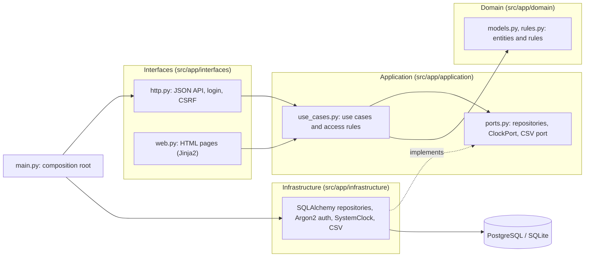
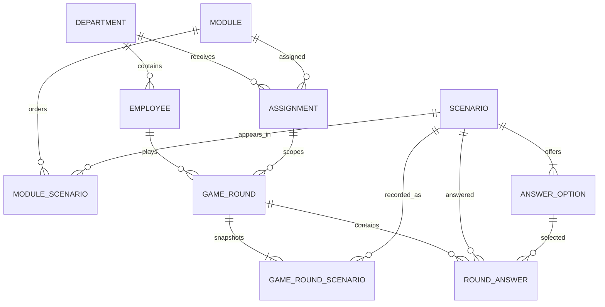
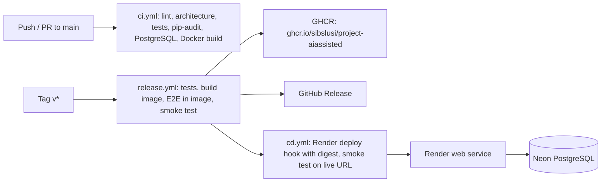

# Data Protection Cases in Local Government

[Deutsch](README.md) · **English**

[](https://github.com/sibslusi/Project-AIAssisted/actions/workflows/ci.yml)
[](https://github.com/sibslusi/Project-AIAssisted/actions/workflows/release.yml)
[](https://ai-sdlc.aisl.science)

A game-based data protection training platform for a fictional Swiss town
administration, modelled on the municipality of Grenchen (Canton of Solothurn,
cantonal information and data protection act InfoDG). Employees play short
scenario rounds from their daily work. The administration assigns modules with
due dates and can prove training status without exposing individuals.

Capstone project for the module *AI-assisted Software Development* (FHNW,
autumn 2026), built with coding agents following the AI-SDLC.

The user interface and the domain texts are in German, because the target
users are Swiss German-speaking municipal staff.

> **Note:** The application uses fictional data only and does not provide
> legal advice. Every page shows this notice.

## Contents

- [Problem and solution](#problem-and-solution)
- [Roles and use cases](#roles-and-use-cases)
- [Live demo](#live-demo)
- [Architecture](#architecture)
- [Domain model](#domain-model)
- [Running locally](#running-locally)
- [Tests and quality](#tests-and-quality)
- [CI/CD and deployment](#cicd-and-deployment)
- [Use of AI](#use-of-ai)
- [Repository layout](#repository-layout)

## Problem and solution

Municipalities have to train their staff in data protection regularly. Today it
is hard to see who has been trained, which risks exist in which department and
whether staff judge real situations at the counter correctly.

The platform addresses this with short rounds of five cases each. Every case
has three to four answers, exactly one of them correct, an explanation and a
legal basis (for example an article of the InfoDG). Feedback appears right
after each answer; a round is passed at 80 % correct answers and earns a badge.

The first version covers three departments with one module of five cases each:
Einwohnerdienste (residents' services), Soziale Dienste (social services) and
Finanzen und Informatik (finance and IT).

## Roles and use cases

| Role | Sees | Can |
|---|---|---|
| Employee | own results only | play and repeat modules of their own department |
| Department lead | status per person in their own department, scores only as team values from 3 people | view reports (no CSV export) |
| Data protection officer | reports for all departments | assign modules with due dates, export training evidence as CSV |

**UC-001: Play a scenario round** ([spec, German](docs/specs/UC-001-SZENARIO-RUNDE-SPIELEN.md))
Employees play an assigned module of five cases, get feedback with explanation
and legal basis after each answer and finally see score, pass status and badge.
An interrupted round is resumed; the best passing attempt counts for the
training status and earlier attempts are kept.

**UC-002: Manage training** ([spec, German](docs/specs/UC-002-SCHULUNG-STEUERN.md))
The data protection officer assigns a module to a department with a due date.
The status is `offen` (open), `erledigt` (done), `Frist überschritten`
(overdue) or `verspätet erledigt` (done late). Department leads only see their
own department (other departments: 403), and team values only appear once at
least three people have completed an attempt. Training evidence can be
exported as CSV (UTF-8 with BOM, semicolon-separated).

UC-003 (AI drafts of new cases) is described in [`docs/PROJECT.md`](docs/PROJECT.md)
as an optional extension and is not implemented.

## Live demo

**URL:** _follows after the first deploy to Render (phase 5)_

All accounts are fictional. The password is the value of `DEMO_PASSWORD`
(locally, for example, `demo`).

| Role | Account | Start page |
|---|---|---|
| Employee (Einwohnerdienste) | `ma@mail.ch` | `/mitarbeitende/module` |
| Department lead (Einwohnerdienste) | `chef@mail.ch` | `/abteilungsleitung/auswertung` |
| Data protection officer | `ds@mail.ch` | `/datenschutz/auswertung`, `/datenschutz/zuweisungen` |

More fictional employees (`…@grenchen.example`) are listed in
[`data/seed/users.json`](data/seed/users.json); they make the team values from
three people visible.

## Architecture

The application follows Clean Architecture. Dependencies always point inward:
`Interfaces / Infrastructure → Application → Domain`.



- **Domain**: entities and pure rules such as scoring, the 80 % pass mark and
  team values from three people. No FastAPI, SQLAlchemy, Jinja2 or HTTPX.
- **Application**: use cases, access rules (covered by unit tests) and ports.
  The current date comes through the `ClockPort`, never from `datetime.now()`.
- **Interfaces**: FastAPI routes, Jinja2 HTML pages, CSV download.
- **Infrastructure**: SQLAlchemy, Argon2 authentication, system clock, CSV
  adapter.
- **Composition root**: `src/app/main.py` wires everything and requires
  `DATABASE_URL`, `SESSION_SECRET` and `DEMO_PASSWORD`.

The layer rules are checked by [import-linter](.importlinter) in every CI run.

**Stack:** Python 3.12, FastAPI, Jinja2, SQLAlchemy 2, Alembic, PostgreSQL 16
(Neon) or SQLite locally, Argon2, pytest, Ruff, Docker.

**Security:** Argon2 password hashes, session cookie with `HttpOnly`, `Secure`
and `SameSite`, CSRF protection on all state-changing requests, role and
department always taken from the server-side session. Modules of another
department return 404, other departments' reports return 403.

### Architecture decision records (ADRs, in German)

| ADR | Decision |
|---|---|
| [ADR-001](docs/adr/ADR-001-STACK.md) | Python/FastAPI stack and Clean Architecture |
| [ADR-002](docs/adr/ADR-002-LOGIN-SESSION-CSRF.md) | Login, session and CSRF |
| [ADR-003](docs/adr/ADR-003-UNVERAENDERLICHE-SZENARIEN.md) | Immutable scenarios and ordered modules |
| [ADR-004](docs/adr/ADR-004-FRISTEN-CLOCKPORT.md) | Due dates via ClockPort and Europe/Zurich |
| [ADR-005](docs/adr/ADR-005-FREMDE-ABTEILUNG.md) | Responses for other departments |
| [ADR-006](docs/adr/ADR-006-DEPLOYMENT.md) | Deployment as a validated image on Render with Neon |

## Domain model

Eight entities, all mapped with the ORM and an Alembic migration:

| Entity | Meaning |
|---|---|
| `Department` | department of the municipality |
| `Employee` | person with a role, belongs to exactly one department |
| `Scenario` | privacy case with situation, explanation, legal basis and `active`; immutable |
| `AnswerOption` | answer option, exactly one per case is correct |
| `Module` | groups five cases through the ordered table `module_scenarios` |
| `Assignment` | assigns a module to a department with a due date |
| `GameRound` | one attempt by a person, with attempt number, score and pass status |
| `RoundAnswer` | selected answer to a case, with timestamp |



Published cases are never edited: a faulty case is deactivated and replaced by
a new one. `game_round_scenarios` records which five cases a round contained,
so historical rounds stay valid
([ADR-003](docs/adr/ADR-003-UNVERAENDERLICHE-SZENARIEN.md)).

## Running locally

### Option A: Python with SQLite

In the dev container (or with Python 3.12), from the repository root:

```bash
python -m venv .venv && source .venv/bin/activate
pip install -r requirements.txt

export DATABASE_URL=sqlite:///./local.db
export SESSION_SECRET=local-secret
export DEMO_PASSWORD=demo
export PYTHONPATH=src

alembic upgrade head
python scripts/seed.py
uvicorn app.main:app --reload
```

Then open `http://localhost:8000/` and sign in with `ma@mail.ch` / `demo`.
The seed can be run repeatedly and never overwrites existing data.

### Option B: Docker Compose with PostgreSQL

```bash
cp .env.example .env   # replace the placeholders with your own values
docker compose up --build
```

On start-up the migrations and the seed run (`RUN_SEED=true`). The app is
available at `http://localhost:8000`. Stop it with `docker compose down`.

### Configuration

| Variable | Purpose |
|---|---|
| `DATABASE_URL` | database (required) |
| `SESSION_SECRET` | signs the session cookie (required) |
| `DEMO_PASSWORD` | password of all fictional demo accounts (required) |
| `APP_VERSION` | version shown in `/health`, set at image build |
| `RUN_SEED` | `true` loads the seed on container start |

Secrets belong only in a local, git-ignored `.env` or in GitHub, Render and
Neon. [`.env.example`](.env.example) contains placeholders only.

## Tests and quality

Development follows TDD (rule in [`AGENTS.md`](AGENTS.md)): the specs map every
acceptance criterion to a test that is written before the code.

| Level | Folder | Tests |
|---|---|---|
| Unit (domain, application, configuration) | `tests/unit/` | 57 |
| Integration (DB, migrations, seed, HTTP, HTML) | `tests/integration/` | 62 |
| End-to-end (UC-001, UC-002 and UI workflows via TestClient) | `tests/e2e/` | 35 |
| **Total** | | **154, coverage 96 %** |

```bash
pytest --cov=src/app --cov-report=term-missing   # all tests with coverage
pytest tests/unit -q                              # a single level
ruff check . && ruff format --check .             # lint and format
PYTHONPATH=src lint-imports                       # architecture rules
pip-audit -r requirements.txt                     # dependencies
```

CI requires at least 90 % coverage. Playwright browser tests were deliberately
left out (reason in [`docs/TASKS.md`](docs/TASKS.md)).

<!-- TODO: link a TDD example (commit with a red test, then a commit with green code). -->

## CI/CD and deployment



| Workflow | Trigger | What it does |
|---|---|---|
| [`ci.yml`](.github/workflows/ci.yml) | push and PR to `main` | Ruff, format, import-linter, all tests with coverage (min. 90 %), `pip-audit`; migrations, `alembic check` and seed (twice) against PostgreSQL 16; Docker build |
| [`release.yml`](.github/workflows/release.yml) | tag `v*` | tests, build versioned image, 35 E2E tests inside the image against PostgreSQL, start container and smoke test; only then push to GHCR, create GitHub release and call `cd.yml` |
| [`cd.yml`](.github/workflows/cd.yml) | called by `release.yml` | in environment `production`: Render deploy hook with the validated image digest, then smoke test against the live URL (version and login) |

Render therefore deploys exactly the image that was tested before, not every
push automatically ([ADR-006](docs/adr/ADR-006-DEPLOYMENT.md)). The database
runs on Neon. On container start `scripts/docker-entrypoint.sh` runs
`alembic upgrade head` and, optionally, the seed.

First release: [`v0.1.0`](https://github.com/sibslusi/Project-AIAssisted/releases/tag/v0.1.0).
**Live URL:** _follows after phase 5_

The smoke test can also be run locally against a running instance:

```bash
BASE_URL=http://localhost:8000 SMOKE_EMAIL=ma@mail.ch DEMO_PASSWORD=demo python scripts/smoke_test.py
```

## Use of AI

The project was built following the AI-SDLC: phases 0 to 5 (bootstrap,
specify, design, develop, validate, deploy), each with a skill and a quality
gate before completion. The current state is in [`docs/TASKS.md`](docs/TASKS.md).

| Tool | Model | Used for |
|---|---|---|
| GitHub Copilot (Chat) | `azure_ai/gpt-6-luna` via LiteLLM | phases 0 and 1: project definition, specs |
| Codex CLI | `gpt-5.6-luna` via the FHNW LiteLLM proxy | phases 2 and 3: design, implementation of UC-001 and UC-002, Docker, UI |
| Claude Code | Claude Opus 5.5 | prompts, code reviews, persona test, pull requests; from 21 Oct also implementation (UI, review fixes, CI/CD, release) |

Only one agent ran at a time (LiteLLM rate limits). Codex has no GitHub
access, so Claude Code opened the PRs and reviewed the code as a second,
independent view.

**How the agents are steered**

- [`AGENTS.md`](AGENTS.md): phase router and project rules (TDD, Clean
  Architecture, small vertical slices).
- [`docs/PROJECT.md`](docs/PROJECT.md): context, architecture, commands.
- [`docs/specs/`](docs/specs/): executable specs with acceptance criteria
  (spec-driven development).
- [`skills/`](skills/): `ai-sdlc-0` to `ai-sdlc-5` per phase, plus the custom
  skills `ai-sdlc-quality-gate` (checklist before closing a phase) and
  `ai-log-eintrag` (log entry after every task).
- MCP: Context7 ([`.vscode/mcp.json`](.vscode/mcp.json)) for up-to-date library
  documentation, read-only.

**Log:** [`docs/AI-LOG.md`](docs/AI-LOG.md) records phase, agent, model, result,
human corrections and lessons learned for every agent task. The prompts used
are in [`docs/PROMPTS.md`](docs/PROMPTS.md). Both are in German.

## Repository layout

```text
src/app/
  domain/          entities and rules
  application/     use cases and ports
  interfaces/      FastAPI routes, Jinja2 templates
  infrastructure/  SQLAlchemy, auth, clock, CSV
  main.py          composition root
alembic/           migrations
data/seed/         fictional seed data (JSON)
scripts/           seed.py, smoke_test.py, deploy.sh, docker-entrypoint.sh
tests/             unit/, integration/, e2e/
docs/
  PROJECT.md       context, architecture, commands
  TASKS.md         phase, status, evidence
  AI-LOG.md        AI log
  PROMPTS.md       prompts per phase
  specs/           UC-001, UC-002
  adr/             ADR-001 to ADR-006
skills/            AI-SDLC and custom skills
```

## Background

Created from the [AI-SDLC template](https://github.com/AIaSDev/ai-sdlc-template).
The method is described in the [AISL documentation](https://docs.aisl.science/learning-and-resources/ai-sdlc).
To use another agent, `bash scripts/setup-skills.sh` links the skills (for
example `codex`, `claude`, `copilot`).
