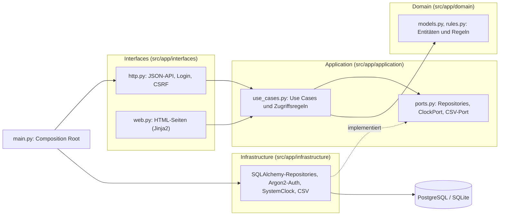
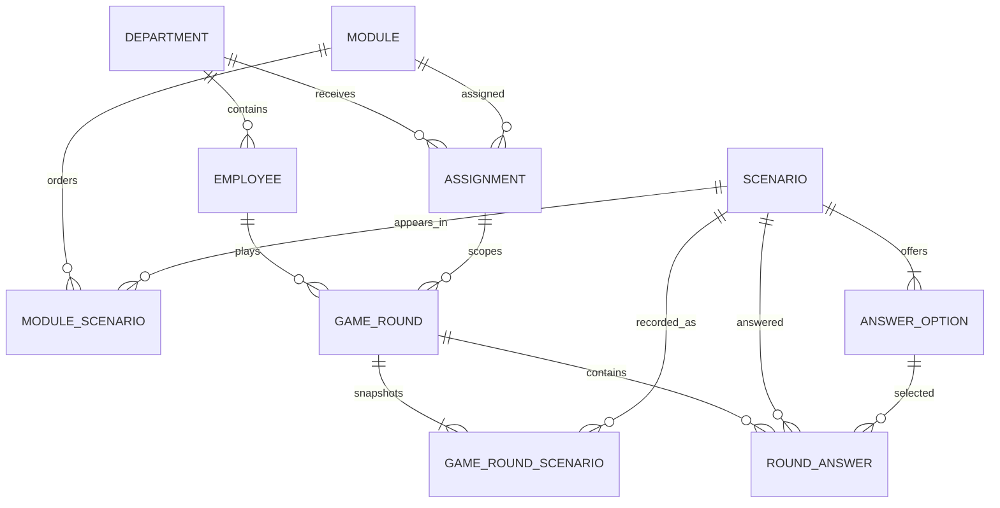
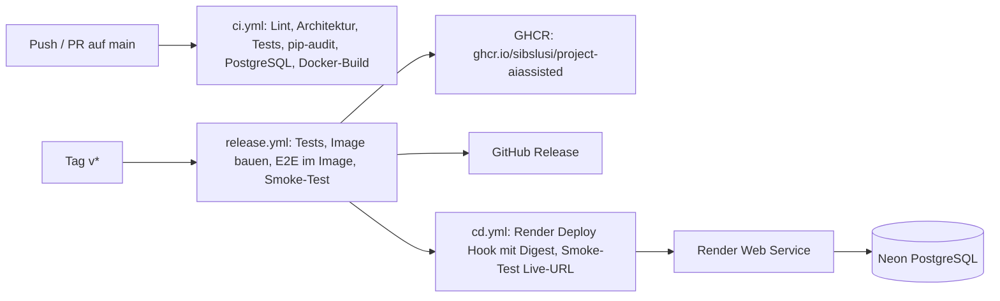

# Datenschutzfälle im Gemeindewesen

**Deutsch** · [English](README.en.md)

[](https://github.com/sibslusi/Project-AIAssisted/actions/workflows/ci.yml)
[](https://github.com/sibslusi/Project-AIAssisted/actions/workflows/release.yml)
[](https://ai-sdlc.aisl.science)

Eine Datenschutz-Schulungsplattform als Spiel für eine fiktive Schweizer
Stadtverwaltung nach dem Vorbild der Gemeinde Grenchen (Kanton Solothurn,
InfoDG). Mitarbeitende lösen kurze Szenario-Runden aus ihrem Arbeitsalltag,
die Verwaltung weist Module mit Frist zu und weist den Schulungsstand nach,
ohne Einzelpersonen blosszustellen.

Capstone-Projekt im Modul *AI-assisted Software Development* (FHNW, HS 2026),
entwickelt nach dem AI-SDLC mit Coding-Agenten.

> **Hinweis:** Die Anwendung verwendet ausschliesslich fiktive Daten und ist
> keine Rechtsberatung. Jede Seite zeigt diesen Hinweis.

## Inhalt

- [Problem und Lösung](#problem-und-lösung)
- [Rollen und Use Cases](#rollen-und-use-cases)
- [Live-Demo](#live-demo)
- [Architektur](#architektur)
- [Domain-Modell](#domain-modell)
- [Lokal starten](#lokal-starten)
- [Tests und Qualität](#tests-und-qualität)
- [CI/CD und Deployment](#cicd-und-deployment)
- [KI-Einsatz](#ki-einsatz)
- [Grenzen der Version 1](#grenzen-der-version-1)
- [Dokumentation im Repository](#dokumentation-im-repository)

## Problem und Lösung

Gemeinden müssen ihre Mitarbeitenden regelmässig im Datenschutz schulen. Heute
ist schwer nachvollziehbar, wer geschult wurde, welche Risiken in einzelnen
Abteilungen bestehen und ob Mitarbeitende Situationen am Schalter richtig
beurteilen.

Die Plattform löst das mit kurzen Runden zu je fünf Fällen. Jeder Fall hat
drei bis vier Antworten (im Seed je vier), genau eine richtige, eine Erklärung
und eine Rechtsgrundlage (zum Beispiel ein Artikel des InfoDG). Nach jeder Antwort gibt
es sofort Feedback; ab 80 % richtigen Antworten ist die Runde bestanden und es
gibt ein Abzeichen.

Die erste Version umfasst drei Abteilungen mit je einem Modul aus fünf Fällen:
Einwohnerdienste, Soziale Dienste sowie Finanzen und Informatik.

## Rollen und Use Cases

| Rolle | Sieht | Darf |
|---|---|---|
| Mitarbeitende | nur eigene Ergebnisse | Module der eigenen Abteilung spielen und wiederholen |
| Abteilungsleitung | Status pro Person der eigenen Abteilung, Punkte nur als Teamwerte ab 3 Personen | auswerten (kein CSV-Export) |
| Datenschutzverantwortliche | Auswertung aller Abteilungen | Module mit Frist zuweisen, Schulungsnachweis als CSV exportieren |

**UC-001: Szenario-Runde spielen** ([Spec](docs/specs/UC-001-SZENARIO-RUNDE-SPIELEN.md))
Mitarbeitende spielen ein zugewiesenes Modul mit fünf Fällen, bekommen pro
Antwort Feedback mit Erklärung und Rechtsgrundlage und sehen am Ende Punktzahl,
Bestehensstatus und Abzeichen. Eine abgebrochene Runde wird fortgesetzt;
für den Status zählt der beste bestandene Versuch, frühere Versuche bleiben
gespeichert.

**UC-002: Schulung steuern** ([Spec](docs/specs/UC-002-SCHULUNG-STEUERN.md))
Die Datenschutzverantwortliche weist einer Abteilung ein Modul mit Frist zu.
Der Status lautet `offen`, `erledigt`, `Frist überschritten` oder
`verspätet erledigt`. Abteilungsleitungen sehen nur ihre Abteilung (fremde
Abteilung: 403), Teamwerte erst ab drei Personen mit abgeschlossenem Versuch.
Der Schulungsnachweis lässt sich als CSV exportieren (UTF-8 mit BOM,
Semikolon).

UC-003 (KI-Entwurf neuer Fälle) ist in [`docs/PROJECT.md`](docs/PROJECT.md)
als optionale Erweiterung beschrieben und nicht umgesetzt.

## Live-Demo

**URL:** <https://grenchen-datenschutz.onrender.com> (Render, Datenbank auf Neon)

Alle Konten sind fiktiv. Das Passwort ist der Wert von `DEMO_PASSWORD`
(lokal zum Beispiel `demo`). Das Passwort der Live-Instanz ist ein Secret und
steht nicht im Repository.

| Rolle | Konto | Einstieg |
|---|---|---|
| Mitarbeitende (Einwohnerdienste) | `ma@mail.ch` | `/mitarbeitende/module` |
| Abteilungsleitung (Einwohnerdienste) | `chef@mail.ch` | `/abteilungsleitung/auswertung` |
| Datenschutzverantwortliche | `ds@mail.ch` | `/datenschutz/auswertung`, `/datenschutz/zuweisungen` |

Weitere fiktive Mitarbeitende (`…@grenchen.example`) stehen in
[`data/seed/users.json`](data/seed/users.json); ihr Passwort ist ebenfalls
`DEMO_PASSWORD`. Der Seed enthält keine gespielten Runden: Damit die
Abteilungsleitung Teamwerte sieht, müssen zuerst drei Personen derselben
Abteilung eine Runde abschliessen.

## Architektur

Die Anwendung folgt der Clean Architecture. Abhängigkeiten zeigen immer nach
innen: `Interfaces / Infrastructure → Application → Domain`.



- **Domain**: Entitäten und reine Regeln wie Bewertung, Bestehensgrenze 80 %
  und Teamwerte ab drei Personen. Kein FastAPI, SQLAlchemy, Jinja2 oder HTTPX.
- **Application**: Use Cases, Zugriffsregeln (mit Unit-Tests abgedeckt) und
  Ports. Das aktuelle Datum kommt über den `ClockPort`, nie über
  `datetime.now()`.
- **Interfaces**: FastAPI-Routen, HTML-Seiten mit Jinja2, CSV-Download.
- **Infrastructure**: SQLAlchemy, Argon2-Authentifizierung, Systemuhr,
  CSV-Adapter.
- **Composition Root**: `src/app/main.py` verdrahtet alles und verlangt
  `DATABASE_URL`, `SESSION_SECRET` und `DEMO_PASSWORD`.

Die Schichtenregeln prüft [import-linter](.importlinter) in jeder CI.

**Stack:** Python 3.12, FastAPI, Jinja2, SQLAlchemy 2, Alembic, PostgreSQL 16
(Neon) bzw. SQLite lokal, Argon2, pytest, Ruff, Docker.

**Sicherheit:** Passwörter mit Argon2, Session-Cookie `HttpOnly`, `Secure`,
`SameSite`, CSRF-Schutz für alle schreibenden Requests. Rolle und Abteilung
kommen aus dem signierten Session-Cookie, nie aus Formularwerten. Fremde Module
ergeben 404, fremde Abteilungen 403
([ADR-005](docs/adr/ADR-005-FREMDE-ABTEILUNG.md)).

**Schnittstellen:** Neben den HTML-Seiten gibt es eine JSON-API, die auch die
E2E-Tests verwenden, zum Beispiel `GET /health` (Status und Version),
`POST /login`, `GET /api/modules`, `POST /api/modules/{id}/rounds`,
`POST /api/rounds/{id}/answers`, `POST /api/assignments`,
`GET /api/training/evaluation` und
`GET /api/assignments/{id}/training-evidence.csv`. Alle Routen stehen in
[`src/app/interfaces/http.py`](src/app/interfaces/http.py).

### Architekturentscheide (ADRs)

| ADR | Entscheid |
|---|---|
| [ADR-001](docs/adr/ADR-001-STACK.md) | Python-FastAPI-Stack und Clean Architecture |
| [ADR-002](docs/adr/ADR-002-LOGIN-SESSION-CSRF.md) | Login, Session und CSRF |
| [ADR-003](docs/adr/ADR-003-UNVERAENDERLICHE-SZENARIEN.md) | Unveränderliche Szenarien und geordnete Module |
| [ADR-004](docs/adr/ADR-004-FRISTEN-CLOCKPORT.md) | Fristen über ClockPort und Europe/Zurich |
| [ADR-005](docs/adr/ADR-005-FREMDE-ABTEILUNG.md) | Antworten für fremde Abteilungen |
| [ADR-006](docs/adr/ADR-006-DEPLOYMENT.md) | Deployment als geprüftes Image auf Render mit Neon |

## Domain-Modell

Acht Entitäten im Domain-Modell. Sieben davon haben eine eigene Tabelle
(ORM-Modelle in `src/app/infrastructure/models.py`, Migration in `alembic/`);
`AnswerOption` wird als JSON-Spalte `options` in `scenarios` gespeichert.
Dazu kommen die Verbindungstabellen `module_scenarios` und
`game_round_scenarios`.

| Entität | Bedeutung |
|---|---|
| `Department` | Abteilung der Gemeinde |
| `Employee` | Person mit Rolle, gehört zu genau einer Abteilung |
| `Scenario` | Datenschutzfall mit Situation, Erklärung, Rechtsgrundlage und `active`; unveränderlich |
| `AnswerOption` | Antwortmöglichkeit, genau eine pro Fall ist richtig |
| `Module` | fasst fünf Fälle über die geordnete Tabelle `module_scenarios` zusammen |
| `Assignment` | weist ein Modul einer Abteilung mit Frist zu |
| `GameRound` | ein Versuch einer Person, mit Versuchsnummer, Punktzahl und Bestehensstatus |
| `RoundAnswer` | gewählte Antwort zu einem Fall mit Zeitpunkt |



Das Diagramm zeigt das logische Modell: `ANSWER_OPTION` ist eine Entität im
Domain-Modell, aber keine eigene Tabelle (siehe oben).

Fälle sind unveränderlich ([ADR-003](docs/adr/ADR-003-UNVERAENDERLICHE-SZENARIEN.md)).
In dieser Version kommen sie ausschliesslich aus den Seed-Daten
([`data/seed/scenarios.json`](data/seed/scenarios.json)); eine Oberfläche zum
Anlegen oder Deaktivieren von Fällen gibt es noch nicht. Das Modell ist dafür
vorbereitet: Neue Runden verwenden nur Fälle mit `active = true`, und
`game_round_scenarios` hält fest, welche fünf Fälle eine Runde hatte, damit
alte Runden gültig bleiben.

## Lokal starten

### Variante A: Python mit SQLite

Im Dev Container (oder mit Python 3.12) aus dem Repository-Root:

```bash
python -m venv .venv && source .venv/bin/activate
pip install -r requirements.txt

export DATABASE_URL=sqlite:///./local.db
export SESSION_SECRET=lokales-geheimnis
export DEMO_PASSWORD=demo
export PYTHONPATH=src

alembic upgrade head
python scripts/seed.py
uvicorn app.main:app --reload
```

Danach `http://localhost:8000/` öffnen und mit `ma@mail.ch` / `demo` anmelden.
Der Seed lässt sich mehrfach ausführen und überschreibt nichts.

### Variante B: Docker Compose mit PostgreSQL

```bash
cp .env.example .env   # Platzhalter durch eigene Werte ersetzen
docker compose up --build
```

Beim Start laufen die Migrationen und der Seed (`RUN_SEED=true`). Die App ist
unter `http://localhost:8000` erreichbar. Beenden mit `docker compose down`.

### Konfiguration

| Variable | Zweck |
|---|---|
| `DATABASE_URL` | Datenbank (Pflicht) |
| `SESSION_SECRET` | Signatur des Session-Cookies (Pflicht) |
| `DEMO_PASSWORD` | Passwort aller fiktiven Demo-Konten (Pflicht) |
| `APP_VERSION` | Version in `/health`, wird beim Image-Build gesetzt |
| `RUN_SEED` | `true` lädt den Seed beim Container-Start |

Geheimnisse gehören nur in eine lokale, ignorierte `.env` oder in GitHub,
Render und Neon. [`.env.example`](.env.example) enthält nur Platzhalter.

## Tests und Qualität

Die Entwicklung folgt TDD (Regel in [`AGENTS.md`](AGENTS.md)): Die Specs
ordnen jedem Akzeptanzkriterium einen Test zu, der vor dem Code geschrieben
wird.

| Ebene | Ordner | Tests |
|---|---|---|
| Unit (Domain, Application, Konfiguration, Smoke-Test-Skript) | `tests/unit/` | 57 |
| Integration (DB, Migrationen, Seed, HTTP, HTML) | `tests/integration/` | 62 |
| End-to-End (Workflows UC-001, UC-002, Oberfläche über TestClient) | `tests/e2e/` | 35 |
| **Total** | | **154, Coverage 96 %** |

```bash
pytest --cov=src/app --cov-report=term-missing   # alle Tests mit Coverage
pytest tests/unit -q                              # nur eine Ebene
ruff check . && ruff format --check .             # Lint und Format
PYTHONPATH=src lint-imports                       # Architekturregeln
pip-audit -r requirements.txt                     # Abhängigkeiten
```

Die CI verlangt mindestens 90 % Coverage. Playwright-Browsertests sind bewusst
nicht umgesetzt (Begründung in [`docs/TASKS.md`](docs/TASKS.md)).

**TDD-Nachweis:** Die Commits zeigen das Muster „zuerst Test, dann Code“,
zum Beispiel:

| Schritt | Commit | Ergebnis |
|---|---|---|
| Rot | `09b97e5` test: redirect logged-in user from home page by role | neuer Test in `tests/integration/test_web.py` schlägt fehl |
| Grün | `7a4020e` fix: redirect logged-in user from home page by role | Änderung nur in `src/app/interfaces/web.py`, Test grün |
| Rot | `b2e6d76` test: Smoke-Test-Skript für Health, Version und Demo-Login | Tests für ein noch fehlendes Skript |
| Grün | `c3bd13d` feat: Smoke-Test-Skript mit Retry, Versionsprüfung und Login | `scripts/smoke_test.py`, Tests grün |

Das erste Paar ist nachgeprüft: Auf `09b97e5` schlägt genau der neue Test fehl
(1 failed, 13 passed), auf `7a4020e` laufen alle 14 Tests durch.

## CI/CD und Deployment



| Workflow | Auslöser | Was er tut |
|---|---|---|
| [`ci.yml`](.github/workflows/ci.yml) | Push und PR auf `main` | Ruff, Format, import-linter, alle Tests mit Coverage (min. 90 %), `pip-audit`; Migrationen, `alembic check` und Seed (zweimal) gegen PostgreSQL 16; Docker-Build |
| [`release.yml`](.github/workflows/release.yml) | Tag `v*` | Tests, Image mit Version bauen, 35 E2E-Tests im Image gegen PostgreSQL, Container starten und Smoke-Test; erst dann Push nach GHCR, GitHub-Release und Aufruf von `cd.yml` |
| [`cd.yml`](.github/workflows/cd.yml) | von `release.yml` | im Environment `production`: Render Deploy Hook mit dem geprüften Image-Digest, danach Smoke-Test gegen die Live-URL (Version und Login) |

Render deployt also genau das Image, das vorher getestet wurde, und nicht
automatisch bei jedem Push ([ADR-006](docs/adr/ADR-006-DEPLOYMENT.md)).
Die Datenbank läuft auf Neon. Beim Container-Start führt
`scripts/docker-entrypoint.sh` `alembic upgrade head` und optional den Seed aus.

Erster Release: [`v0.1.0`](https://github.com/sibslusi/Project-AIAssisted/releases/tag/v0.1.0).
**Live-URL:** <https://grenchen-datenschutz.onrender.com>

Den Smoke-Test kann man auch lokal gegen eine laufende Instanz ausführen:

```bash
BASE_URL=http://localhost:8000 SMOKE_EMAIL=ma@mail.ch DEMO_PASSWORD=demo python scripts/smoke_test.py
```

## KI-Einsatz

Das Projekt wurde nach dem AI-SDLC entwickelt: Phasen 0 bis 5 (Bootstrap,
Specify, Design, Develop, Validate, Deploy), jeweils mit einem Skill und einem
Quality Gate vor dem Abschluss. Der aktuelle Stand steht in
[`docs/TASKS.md`](docs/TASKS.md).

| Werkzeug | Modell | Einsatz |
|---|---|---|
| GitHub Copilot (Chat) | `azure_ai/gpt-6-luna` über LiteLLM | Phase 0 und 1: Projektdefinition, Specs |
| Codex CLI | `gpt-5.6-luna` über den LiteLLM-Proxy der FHNW | Phase 2 und 3: Design, Umsetzung von UC-001 und UC-002, Docker, Oberfläche |
| Claude Code | Claude Opus 5.5 | Prompts, Code-Reviews, Persona-Test, Pull Requests; ab 21.10. auch Umsetzung (Oberfläche, Review-Fixes, CI/CD, Release) |

Es lief immer nur ein Agent gleichzeitig (Rate Limits von LiteLLM). Codex hat
keinen GitHub-Zugang, deshalb öffnete Claude Code die PRs und prüfte den Code
als zweiter, unabhängiger Blick.

**Steuerung der Agenten**

- [`AGENTS.md`](AGENTS.md): Router für die Phasen und Projektregeln (TDD,
  Clean Architecture, kleine vertikale Schnitte).
- [`docs/PROJECT.md`](docs/PROJECT.md): Kontext, Architektur, Befehle.
- [`docs/specs/`](docs/specs/): ausführbare Specs mit Akzeptanzkriterien
  (spec-driven development).
- [`skills/`](skills/): `ai-sdlc-0` bis `ai-sdlc-5` pro Phase, dazu eigene
  Skills `ai-sdlc-quality-gate` (Checkliste vor jedem Phasenabschluss) und
  `ai-log-eintrag` (Protokolleintrag nach jeder Aufgabe).
- MCP: Context7 ([`.vscode/mcp.json`](.vscode/mcp.json)) für aktuelle
  Bibliotheksdokumentation, nur lesend.

**Protokoll:** [`docs/AI-LOG.md`](docs/AI-LOG.md) hält pro Agentenauftrag
Phase, Agent, Modell, Ergebnis, menschliche Korrekturen und Lernpunkte fest.
Die verwendeten Prompts stehen in [`docs/PROMPTS.md`](docs/PROMPTS.md).

## Grenzen der Version 1

- Fälle kommen nur aus den Seed-Daten; eine Oberfläche zum Anlegen oder
  Deaktivieren fehlt noch.
- UC-003 (KI-Entwurf von Fällen) ist nicht umgesetzt.
- Keine Registrierung, kein Single Sign-on, keine E-Mail-Benachrichtigungen.
- Keine Browser-Tests mit Playwright; die Oberfläche ist über TestClient-Tests
  abgedeckt.
- Das Session-Cookie ist `Secure`: Lokal funktioniert der Login in den meisten Browsern über
  `http://localhost`, sonst nur über HTTPS.

## Dokumentation im Repository

```text
src/app/
  domain/          Entitäten und Regeln
  application/     Use Cases und Ports
  interfaces/      FastAPI-Routen, Jinja2-Templates
  infrastructure/  SQLAlchemy, Auth, Clock, CSV
  main.py          Composition Root
alembic/           Migrationen
data/seed/         fiktive Seed-Daten (JSON)
scripts/           seed.py, smoke_test.py, deploy.sh, docker-entrypoint.sh
tests/             unit/, integration/, e2e/
docs/
  PROJECT.md       Kontext, Architektur, Befehle
  TASKS.md         Phase, Status, Nachweise
  AI-LOG.md        KI-Protokoll
  PROMPTS.md       Prompts pro Phase
  specs/           UC-001, UC-002
  adr/             ADR-001 bis ADR-006
skills/            AI-SDLC- und eigene Skills
```

## Grundlage

Erstellt aus dem [AI-SDLC-Template](https://github.com/AIaSDev/ai-sdlc-template).
Die Methode ist in der [AISL-Dokumentation](https://docs.aisl.science/learning-and-resources/ai-sdlc)
beschrieben. Für einen anderen Agenten verlinkt `bash scripts/setup-skills.sh`
die Skills (zum Beispiel `codex`, `claude`, `copilot`).
