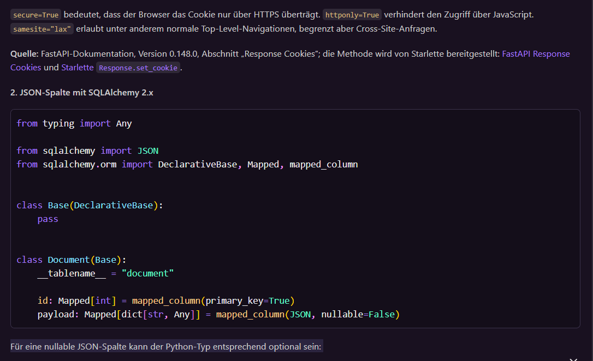
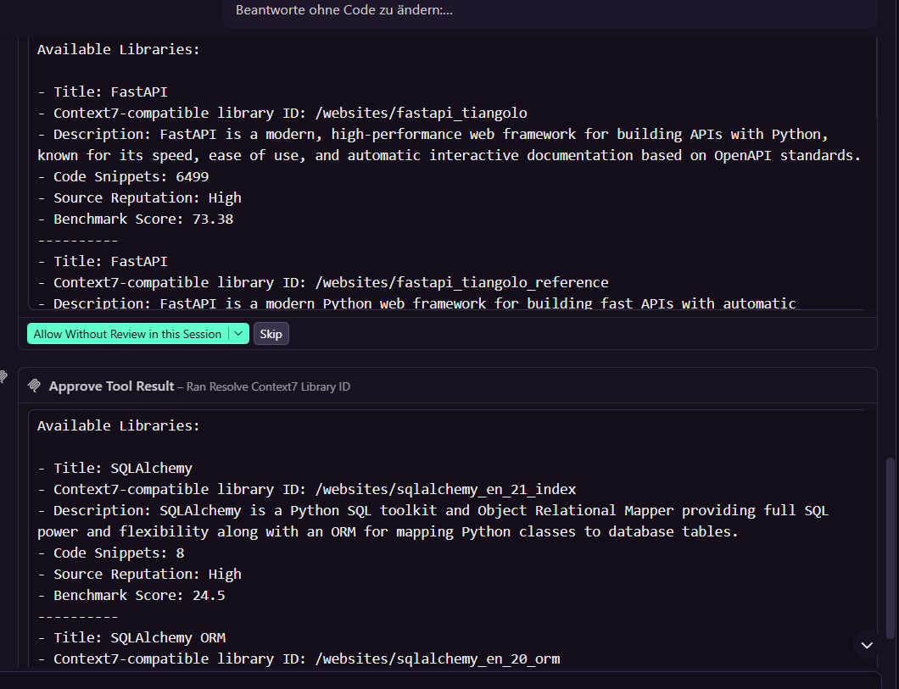
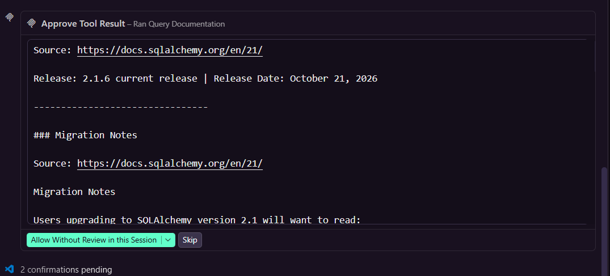
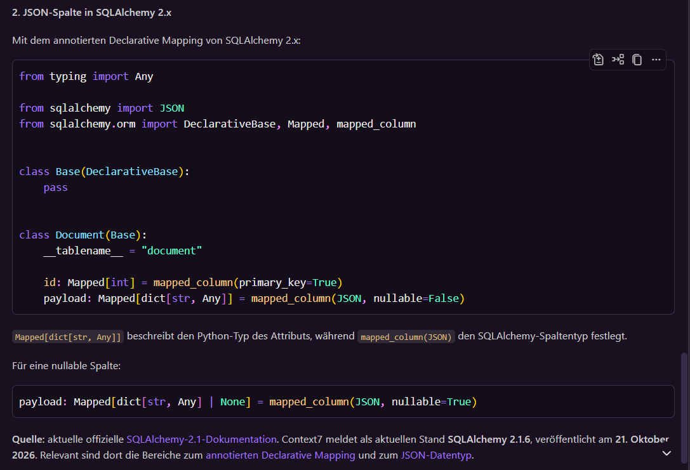

# MCP-Nachweis: Context7 ohne und mit MCP

Durchgeführt am 2026-10-25 von Sibslusi in GitHub Copilot Chat (VS Code, Modus
Agent), Modell `gpt-5.6-luna` über den FHNW-LiteLLM-Proxy. Der MCP-Server
Context7 ist in [`.vscode/mcp.json`](../.vscode/mcp.json) eingetragen.

## Versuchsaufbau

Beide Durchläufe nutzten dasselbe Modell, je einen neuen Chat und dieselbe Frage:

```
Wir nutzen FastAPI 0.148 und SQLAlchemy 2.1.
Beantworte ohne Code zu ändern:
1. Wie setze ich in FastAPI ein Cookie mit HttpOnly, Secure und SameSite=lax in einer Response?
2. Wie deklariere ich in SQLAlchemy 2.x eine JSON-Spalte mit Mapped und mapped_column?
Nenne für jede Antwort die Quelle bzw. Doku-Version, auf die du dich stützt.
```

| Durchlauf | Werkzeuge (Configure Tools) | Zusatz im Prompt |
|---|---|---|
| A, ohne MCP | alle aus (0 Selected) | „Nutze keine Werkzeuge, antworte nur aus deinem eigenen Wissen.“ |
| B, mit MCP | nur Context7 (`resolve-library-id`, `query-docs`) | „Nutze dafür nur den MCP-Server context7 und hole die aktuelle Doku zu FastAPI und SQLAlchemy.“ |

Auch `read`, `search` und Pylance waren aus. So konnte der Agent die Lösung
nicht aus `src/app/` abschreiben und auch nicht per `curl` im Terminal suchen.

## Ergebnis

| | A, ohne MCP | B, mit Context7 |
|---|---|---|
| Code | `response.set_cookie(httponly=True, secure=True, samesite="lax")` und `Mapped[...] = mapped_column(JSON)` | gleich |
| Quelle | „FastAPI 0.148.0“ und „SQLAlchemy 2.1“, also die Versionen aus der Frage, nicht nachgeprüft | `set_cookie`-Signatur aus fastapi.tiangolo.com/reference/response; SQLAlchemy-Doku docs.sqlalchemy.org/en/21 mit Stand **2.1.6, Release 21. Oktober 2026** |
| Ehrlichkeit | nennt eine Version, die es nicht belegt | sagt offen, dass die FastAPI-Seite keine eigene Versionsnummer nennt |
| Werkzeugaufrufe | keine | `resolve-library-id` für beide Bibliotheken, danach mehrere `query-docs` (laut Copilot 7 Schritte in 25 s) |

Beide Antworten stimmen mit dem Projektcode überein:
`set_cookie` in [`src/app/interfaces/http.py`](../src/app/interfaces/http.py) und
`options: Mapped[list[dict]] = mapped_column(JSON)` in
[`src/app/infrastructure/models.py`](../src/app/infrastructure/models.py).

**Fazit:** Bei diesen stabilen APIs war auch das Modellwissen richtig. Der Mehrwert
von Context7 liegt in der überprüfbaren Quelle und im aktuellen Versionsstand.
Ohne MCP hat das Modell eine Quellenangabe vorgetäuscht, indem es die Version aus
der Frage übernommen hat.

## Belege

Ohne MCP, Quellenangabe aus dem Modellwissen:



Mit MCP, Aufruf `resolve-library-id` findet FastAPI und SQLAlchemy 2.1:



Mit MCP, Aufruf `query-docs` liefert den aktuellen Stand von SQLAlchemy:



Mit MCP, Antwort mit belegten Quellen:


