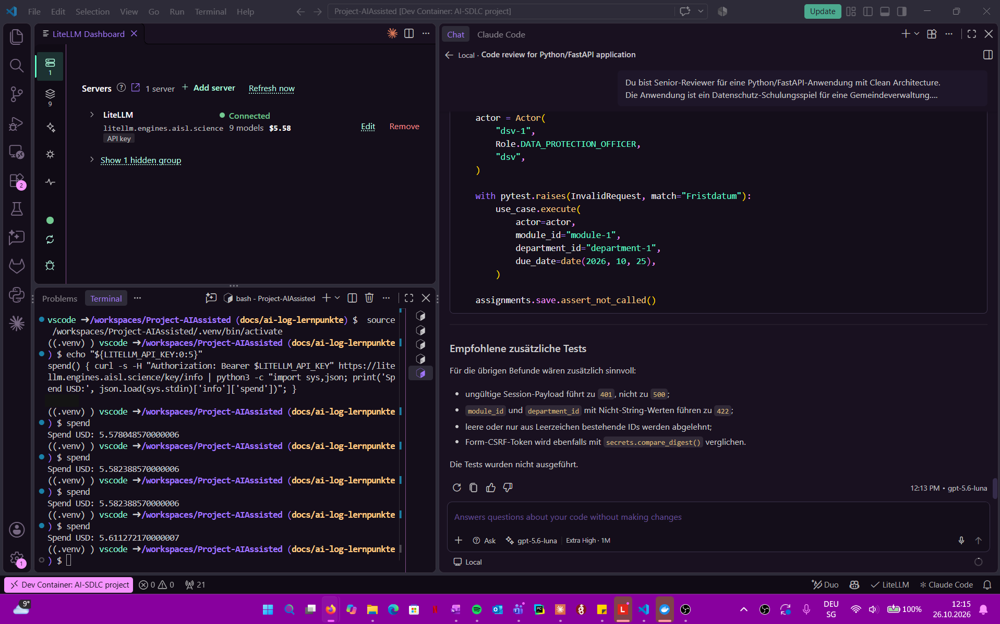
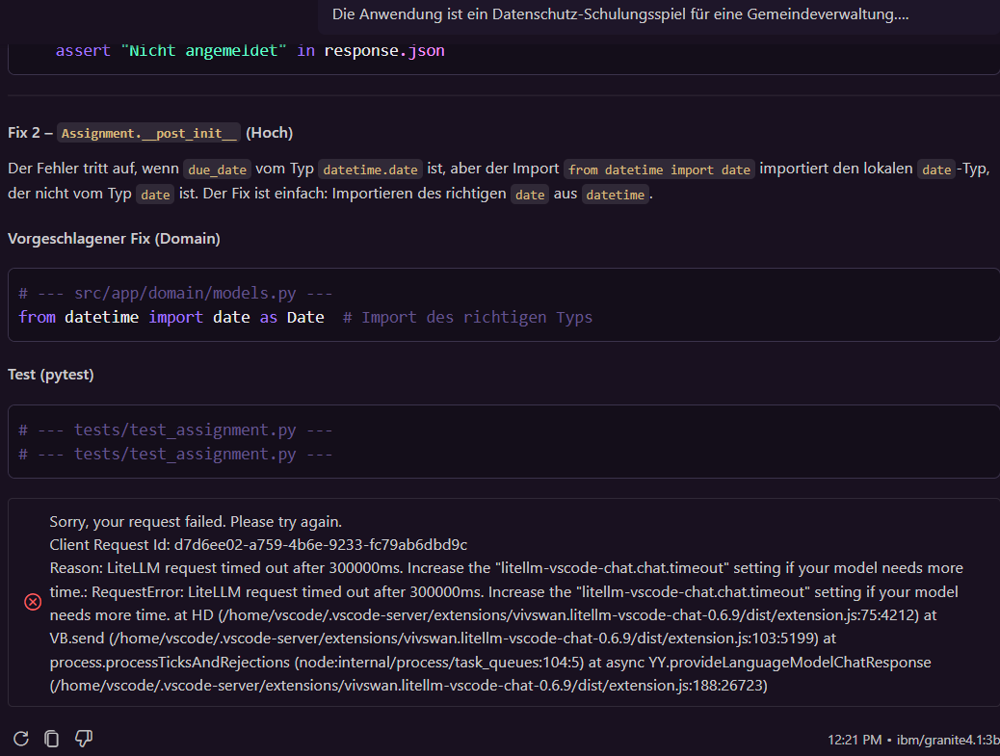
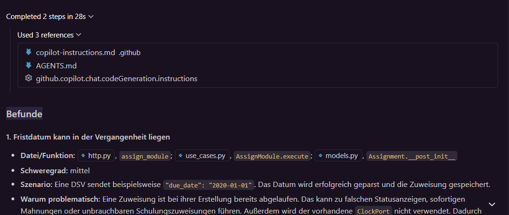

# Modellvergleich: Code-Review mit mehreren Modellen (SW3)

SW3-Aufgabe: „give the same small capstone task to two different models (e.g. a frontier model and
an open-weight model) – Quality of the result? Time? Cost (see spend in LiteLLM)?“

Aufgabe hier: derselbe Code-Review-Prompt mit demselben Code an mehrere Modelle. Ziel ist, die
Modellwahl mit Beleg statt Bauchgefühl zu begründen.

## Versuchsaufbau

| Punkt | Festlegung |
|---|---|
| Werkzeug | VS Code, GitHub Copilot Chat (Local), Modus **Ask**, Standardwerkzeuge von Ask unverändert |
| Lauf A | `gpt-5.6-luna` (Frontier), Denkstufe **Extra High** |
| Lauf B | `ibm/granite4.1:3b` (Open-Weight), keine Denkstufe wählbar |
| Lauf C | `gpt-5.6-luna`, Denkstufe **Low** (Einfluss der Denkstufe) |
| Prompt | [modellvergleich/prompt.md](modellvergleich/prompt.md), als Ganzes eingefügt, plus die Zeile `Führe den Code-Review aus dem angehängten Text aus. Antworte direkt, ohne /fix oder /tests.` |
| Code | `main` Commit `27e63a4` (= Release v0.1.1): Logout/Session-Handling in `src/app/interfaces/http.py`, Fristlogik in `AssignModule` und `Assignment` |
| Kontext | Pro Lauf ein neuer Chat, keine angehängte Datei (Kontext-Chip entfernt) |
| Zeit | Anzeige „Completed … in …“ in Copilot |
| Kosten | Spend des LiteLLM-Keys über `GET /key/info` (Funktion `spend` im Terminal), vor dem Lauf und **3 Minuten nach** dem Lauf, weil LiteLLM verzögert verbucht |

Warum kein Apertus: Apertus (Swiss AI) ist ohne Swiss-AI-Key nicht auswählbar, deshalb das offene
Modell Granite 4.1 aus dem LiteLLM.

## Bekannte Fehler im geprüften Code (Lösungsschlüssel)

- **B2:** Logout löscht nur die Cookies im Browser. Das signierte Session-Cookie bleibt bis
  8 h nach dem Login gültig, ein kopiertes Cookie funktioniert nach dem Abmelden weiter.
- **B3:** `AssignModule` akzeptiert Fristen in der Vergangenheit.

## Ergebnisse

### Lauf A: gpt-5.6-luna (Extra High)

| Messwert | Wert |
|---|---|
| Zeit | 2 min 48 s („Completed 2 steps in 2m 48s“) |
| Spend vorher / nachher | 5.582388570 / 5.611272170 USD |
| Kosten | **0.0289 USD** |
| Antwort | [antwort-lauf-a.md](modellvergleich/antwort-lauf-a.md) |
| Bewertung | **6 / 10** (siehe [Bewertung](#bewertung)) |

### Lauf B: ibm/granite4.1:3b

| Messwert | Wert |
|---|---|
| Zeit | Abbruch nach **300 s** (LiteLLM-Timeout `litellm-vscode-chat.chat.timeout`), Antwort unvollständig |
| Spend vorher / nachher | 5.611272170 / 5.611272170 USD (auch >10 min nach dem Lauf unverändert) |
| Kosten | **0.0000 USD**. Zwei mögliche Gründe: für das Modell ist im LiteLLM kein Preis hinterlegt, oder der abgebrochene Request wurde nicht verbucht. Für den ersten spricht, dass auch vollständige Granite-Antworten im Vorversuch 0 USD kosteten (nicht geprüft). |
| Antwort | [antwort-lauf-b.md](modellvergleich/antwort-lauf-b.md) |
| Bewertung | **0 / 10** (siehe [Bewertung](#bewertung)) |

Gegen den Code geprüft (Claude): Keiner der fünf Befunde trifft zu, B2 und B3 fehlen.

| Befund von Granite | Prüfung |
|---|---|
| `_actor` ohne Cookie | Falsch: Ohne Cookie liefert `_actor` `None`, `_require_actor` antwortet korrekt mit 401. |
| CSRF nur beim Logout geprüft | Falsch: `_check_csrf` läuft auch in `/api/assignments` und `start_round`. |
| `from datetime import date` sei der falsche Typ | Falsch: Der Import ist korrekt; der Fix `date as Date` ändert nichts. |
| DSV kann jeder Abteilung zuweisen | Kein Fehler: Die DSV ist laut Rollenmodell für alle Abteilungen zuständig. |
| `fromisoformat` lehnt Datum mit Uhrzeit ab | Kein Fehler: 422 bei falschem Format ist gewollt. |

Die Fixes verletzen zudem die Architektur (FastAPI-Import in der Domain, HTTP-Code im
Application-Layer), und der Test zu Fix 2 ist leer.

### Lauf C: gpt-5.6-luna (Low)

| Messwert | Wert |
|---|---|
| Zeit | 28 s („Completed 2 steps in 28s“) |
| Spend vorher / nachher | 5.578048570 / 5.582388570 USD |
| Kosten | **0.0043 USD** |
| Antwort | [antwort-lauf-c.md](modellvergleich/antwort-lauf-c.md) |
| Bewertung | **4 / 10** (siehe [Bewertung](#bewertung)) |

## Übersicht

| Lauf | Modell | Zeit | Kosten | B2 | B3 | Falschbefunde | Punkte |
|---|---|---|---|---|---|---|---|
| A | gpt-5.6-luna Extra High | 2 min 48 s | 0.0289 USD | nein | ja („unsicher“) | 0 | 6 / 10 |
| B | ibm/granite4.1:3b | Abbruch nach 300 s | 0.0000 USD | nein | nein | 5 von 5 | 0 / 10 |
| C | gpt-5.6-luna Low | 28 s | 0.0043 USD | nein | ja | 0 | 4 / 10 |

## Bewertung

Punkte nach dem Lösungsschlüssel: B2 gefunden (0–2), B3 gefunden (0–2), Fix B2 (0–3),
Fix B3 (0–3), max. 10. Vorschlag von Claude gegen den Code geprüft, von Sibslusi übernommen (28.10.2026).

| Kriterium | A: Extra High | C: Low | B: Granite |
|---|---|---|---|
| B2 gefunden (0–2) | 0 | 0 | 0 |
| B3 gefunden (0–2) | 2 | 2 | 0 |
| Fix B2 (0–3) | 1 | 0 | 0 |
| Fix B3 (0–3) | 3 | 2 | 0 |
| **Total (max. 10)** | **6** | **4** | **0** |
| Zusatzbefunde | Z1, Z2 | Z1, Z2 | keine |
| Falschbefunde | 0 | 0 | 5 |
| Tests sinnvoll | teilweise (falsche Importpfade) | teilweise (falsche Importpfade) | nein |

Begründung:

- **B2:** A und C sehen, dass das Cookie 8 h gültig bleibt, verbinden das aber nur mit
  Rollenwechseln (Z1), nicht mit Logout oder einem kopierten Cookie.
- **B3:** Beide nennen die Lücke klar mit Szenario (A mit `2020-01-01`).
- **Fix B2:** A lädt Rolle und Abteilung serverseitig über Ports. Das löst Z1, nach dem Logout
  bleibt das Cookie aber gültig („ungenügend“). C hat keinen Fix für die Session-Gültigkeit.
- **Fix B3:** A nutzt den echten `ClockPort.now()` mit Europe/Zurich, `InvalidRequest` und einen
  Fake-Clock-Test. C nimmt einen `ClockPort.today()` an, den es nicht gibt.
- **B:** alle fünf Befunde falsch, Abbruch nach 300 s.

Ermessensstellen: A bei B2 gefunden (0 oder 1, „vage“), A bei Fix B3 (3 oder 2, Test läuft wegen
falscher Imports nicht direkt), C bei Fix B3 (2 oder 1, Code läuft erst mit ergänztem `today()`).
Damit liegt A bei 5–7, C bei 3–4, B bei 0 Punkten. Die Reihenfolge A vor C vor B bleibt in jeder Variante gleich.

## Fazit

Ich habe dieselbe Code-Review-Aufgabe dreimal gestellt. gpt-5.6-luna mit Extra High (A) brauchte
2:48 Minuten und 0.0289 USD und erreichte 6 von 10 Punkten. Mit Low (C) brauchte dasselbe Modell
28 Sekunden und 0.0043 USD, also etwa siebenmal weniger. Es fand dieselben Fehler, schlug aber
ungenauere Fixes vor (4 Punkte). Das kleine Open-Weight-Modell granite4.1:3b (B) brach nach
300 Sekunden ab, und alle fünf Befunde waren falsch (0 Punkte). Die Logout-Lücke (B2) fand keines
der Modelle. Für mich heisst das: Fürs Finden reicht ein günstiges Modell, für Fixes lohnt sich
mehr Denkzeit, und eine KI-Review ersetzt keine eigene Prüfung.

## Vergleich der beiden gpt-5.6-luna-Läufe

Geprüfte Gegenüberstellung von Lauf A und Lauf C: [modellvergleich/vergleich-a-c.md](modellvergleich/vergleich-a-c.md).

## Einschränkungen des Versuchs

- Copilot Ask hat standardmässig Lese- und Suchwerkzeuge für den Workspace aktiv. Die Modelle
  hätten also zusätzlich Dateien lesen können; die Werkzeuge sind für alle Läufe gleich.
- **Copilot hängt Projekt-Instruktionen automatisch an.** Laut „Used 3 references“ las Copilot
  `.github/copilot-instructions.md`, `AGENTS.md` und die Einstellung
  `github.copilot.chat.codeGeneration.instructions` mit. Der Input war also nicht nur der Prompt,
  aber für alle Läufe gleich.
- Pro Modell ein Lauf; Ergebnisse können bei Wiederholung abweichen.
