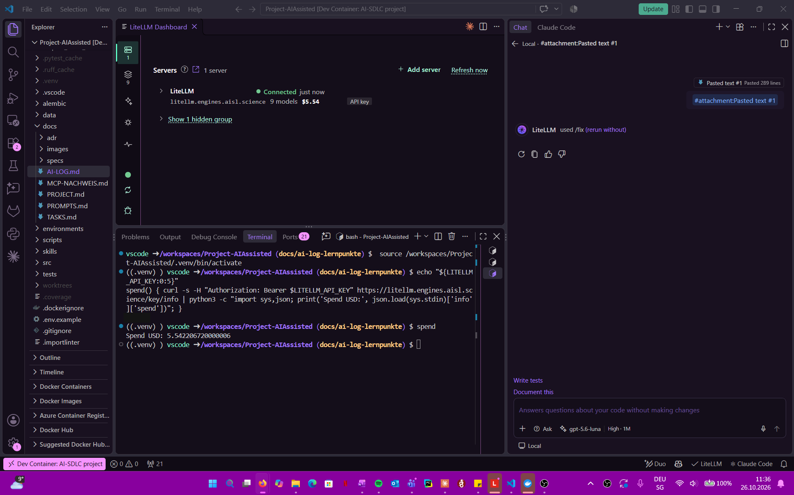
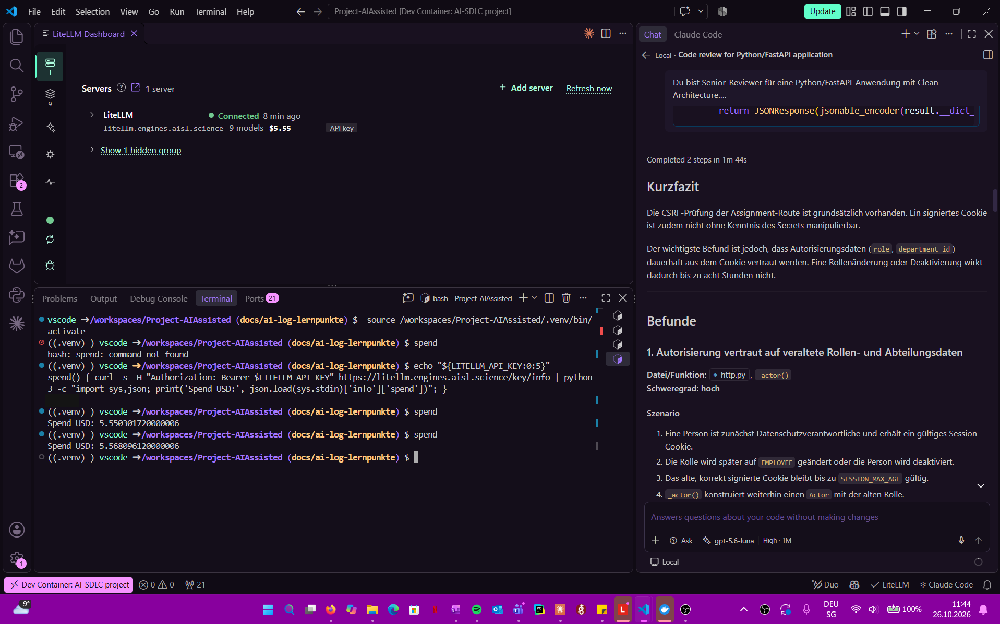

# Modellvergleich: Code-Review mit zwei Modellen (SW3)

Gleicher Review-Prompt, gleicher Code, zwei Modelle. Ziel: Modellwahl mit Beleg statt Bauchgefühl
begründen (Qualität, Zeit, Kosten).

## Einstellungen (Stand 26.10.2026)

| Punkt | Festlegung |
|---|---|
| Werkzeug | VS Code, GitHub Copilot Chat, Modus **Ask** (liest nur, ändert keine Dateien) |
| Modell A | `gpt-5.6-luna` über LiteLLM (`litellm.engines.aisl.science`), Denkstufe **High** |
| Modell B | folgt (gleiche Denkstufe wie Modell A) |
| Kontext | Kein `#codebase`, keine angehängte Datei, keine MCP-Werkzeuge; nur der Prompt mit eingefügtem Code |
| Chat | Für jedes Modell ein neuer Chat |
| Code | `main` Commit `27e63a4` (= Release v0.1.1): Logout/Session-Handling in `src/app/interfaces/http.py`, Fristlogik in `AssignModule` und `Assignment` |
| Zeit | Stoppuhr ab Abschicken bis Antwort fertig |
| Kosten | Spend des LiteLLM-Keys vor und nach jedem Lauf über `GET /key/info` (Terminal, Funktion `spend`); das Dashboard zeigt nur 2 Nachkommastellen |

Prompt: [modellvergleich/prompt.md](modellvergleich/prompt.md).

Spend vor Lauf A: **5.542206720 USD** (Terminal im Screenshot, Key-Anfang geschwärzt).

## Beobachtungen bei der Durchführung

- **Copilot wählt selbst einen Befehl.** Ein langer eingefügter Prompt wird zum Anhang
  „Pasted text“, das Eingabefeld bleibt leer. Copilot hat daraus zweimal selbst einen Befehl
  abgeleitet: zuerst `/fix` (keine Antwort), dann `/tests` (Fehler „To generate tests, open a file
  and select code to test.“). Beide Versuche zählen nicht. Lösung: zusätzlich die Zeile
  `Führe den Code-Review aus dem angehängten Text aus. Antworte direkt, ohne /fix oder /tests.`
  ins Eingabefeld tippen, für beide Modelle gleich.
- **Dritter Versuch bewertete den Prompt statt den Code** (gpt-5.6-luna, High, 33 s, 0.0081 USD).
  Es war mehr als nur der Prompt im Chat gelandet, das Modell kannte deshalb den Lösungsschlüssel
  und schrieb eine Kritik am Versuchsaufbau. Zählt nicht als Lauf A. Nützlich war ein Hinweis
  daraus: Im Code-Ausschnitt fehlte die letzte Zeile von `assign_module`
  (`return JSONResponse(...)`), das wurde korrigiert. Vorgeschlagene „verbindliche Anforderungen“
  wurden nicht übernommen, weil sie B2 und B3 verraten würden. Seither liegt der Prompt allein in
  einer eigenen Datei, die komplett kopiert wird.
- **Kontext wird automatisch angehängt.** Die offene Datei im Editor (hier `AI-LOG.md`) hing als
  Kontext-Chip am Chat und musste entfernt werden, damit beide Modelle denselben Input bekommen.
- **Denkstufe** wechselte zwischen den Versuchen von Extra High auf High; festgelegt ist High für
  beide Modelle.

Lernpunkt für die Reflexion: Auch im Modus Ask verändert das Werkzeug den Input (Intent-Erkennung,
impliziter Kontext). Für einen fairen Vergleich muss man diese Automatismen kennen und ausschalten.

## Bekannte Fehler im geprüften Code (Lösungsschlüssel)

- **B2:** Logout löscht nur die Cookies im Browser. Das signierte Session-Cookie bleibt bis
  8 h nach dem Login gültig, ein kopiertes Cookie funktioniert nach dem Abmelden weiter.
- **B3:** `AssignModule` akzeptiert Fristen in der Vergangenheit.

## Ergebnisse

### Lauf A: gpt-5.6-luna (High), 26.10.2026 11:42

| Messwert | Wert |
|---|---|
| Zeit (laut Copilot „Completed 2 steps in …“) | 1 min 44 s |
| Spend vorher / nachher | 5.550301720 / 5.568096120 USD |
| Kosten | **0.0178 USD** |
| Antwort | [antwort-modell-a.md](modellvergleich/antwort-modell-a.md) |
| Bewertung | folgt (Sibslusi) |

### Lauf B: ibm/granite4.1:3b (Open-Weight), 26.10.2026 ca. 11:54

Die SW3-Aufgabe nennt als Beispiel „a frontier model and an open-weight model“. Apertus (Swiss AI)
war ohne Swiss-AI-Key nicht auswählbar, deshalb das offene Modell Granite 4.1 (3B) aus dem LiteLLM.

| Messwert | Wert |
|---|---|
| Denkstufe | keine Auswahl (Modell bietet keine an) |
| Zeit | folgt |
| Kosten | folgt |
| Antwort | [antwort-modell-b.md](modellvergleich/antwort-modell-b.md): nur ein JSON-Titel, kein Review |
| Bewertung | folgt (Sibslusi) |

### Einschränkungen des Versuchs

- Copilot Ask hat standardmässig Lese- und Suchwerkzeuge für den Workspace aktiv (20 Werkzeuge).
  Beide Modelle hätten also zusätzlich Dateien lesen können. Die Werkzeuge wurden für beide Läufe
  gleich gelassen.
- Pro Modell ein Lauf; Ergebnisse können bei Wiederholung abweichen.
