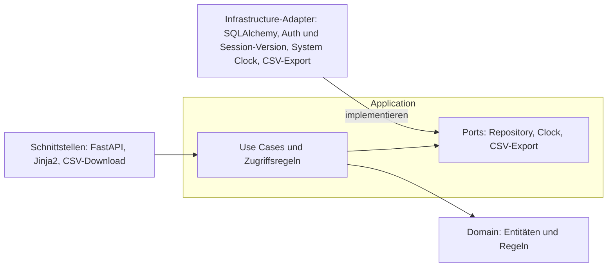
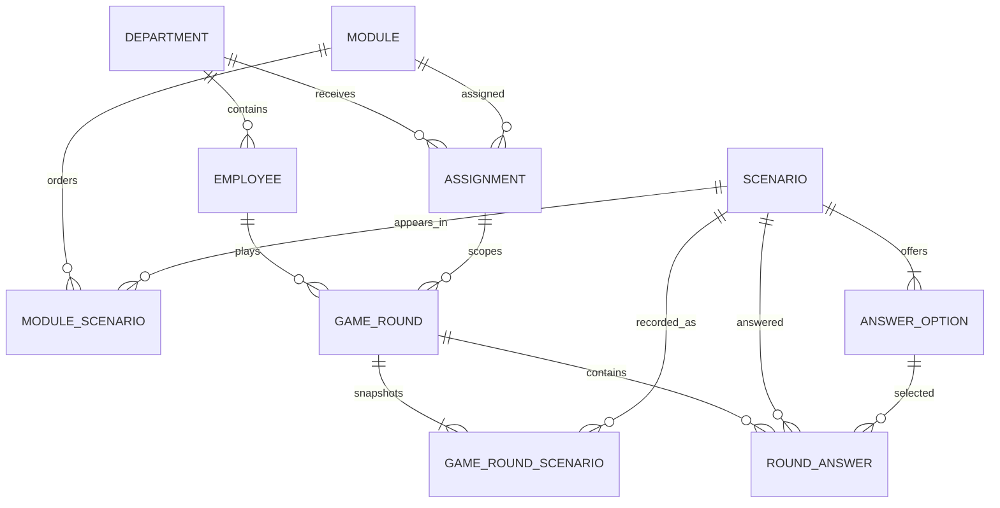

# Datenschutzfälle im Gemeindewesen

## Purpose

Gemeinden müssen Mitarbeitende regelmässig im Datenschutz schulen. Heute ist
schwer nachvollziehbar, wer geschult wurde, welche Risiken in einzelnen
Abteilungen bestehen und ob Mitarbeitende Datenschutzsituationen im Arbeitsalltag
korrekt beurteilen können.

Das Projekt entwickelt dafür eine Compliance-Schulungsplattform für eine
fiktive Schweizer Stadtverwaltung. Mitarbeitende trainieren typische
Datenschutzsituationen in kurzen Szenario-Runden. Die Verwaltung kann den
Schulungsstatus nachweisen und Risiken auf Teamebene erkennen, ohne einzelne
Mitarbeitende durch Detailauswertungen offenzulegen.

Die Anwendung ist eine interaktive Datenschutz-Schulungsplattform.
Mitarbeitende lösen realistische, auf Grenchen zugeschnittene Datenschutzfälle
aus ihrem Arbeitsalltag. Sie erhalten direkt eine Erklärung und eine Bewertung.
Abteilungsleitungen sehen anonymisierte beziehungsweise aggregierte Ergebnisse
ihrer Abteilung. Datenschutzverantwortliche können Fälle und Schulungsmodule
verwalten sowie den Schulungsstand der Gemeinde kontrollieren.

### Kernfunktionen der ersten Version

1. Login für Mitarbeitende, Abteilungsleitungen und
	Datenschutzverantwortliche mit fiktiven Seed-Demo-Benutzern.
2. Datenschutzfälle als interaktive Szenarien lösen.
3. Sofortige Bewertung mit Erklärung.
4. Schulungsfortschritt und Abschlussstatus anzeigen.
5. Aggregierte Abteilungsauswertung anzeigen.
6. Schulungsmodule mit Frist zuweisen. Das Anlegen und Deaktivieren von
	Fällen über die Oberfläche ist in V1 nicht umgesetzt (siehe „Verwaltung
	von Fällen und Modulen“).

### Zielgruppe und Rollen

Die Anwendung richtet sich primär an Mitarbeitende der Gemeinde Grenchen und
ist auf deren Verwaltungsalltag zugeschnitten. Die Grundstruktur soll später
auch von anderen Gemeinden übernommen werden können.

- **Mitarbeitende** der Gemeinde Grenchen spielen Szenarien ihrer eigenen
  Abteilung und sehen nur ihre eigenen Ergebnisse.
- **Abteilungsleitungen** sehen den Schulungsstatus der eigenen Abteilung.
  Punkte und Fehler werden nur aggregiert und erst ab drei Personen angezeigt.
- **Datenschutzverantwortliche** verwalten Szenarien, weisen Module zu und
  sehen die Auswertung aller Abteilungen.

### In scope

- Login mit fiktiven Seed-Demo-Benutzern im Format `@grenchen.example` und
	Passwort. Benutzer, Abteilung und Rolle werden serverseitig aus dem Seed
	geladen. Eine öffentliche Registrierung beziehungsweise `Create account` ist
	nicht Teil der V1 und bleibt eine spätere Erweiterung.
- Die erste Version enthält realistische, fiktive Datenschutzfälle aus dem
	Arbeitsalltag einer Gemeinde nach dem Vorbild von Grenchen (Kanton
	Solothurn, InfoDG).
- Abgedeckt sind die Abteilungen Einwohnerdienste, Soziale Dienste sowie
	Finanzen und Informatik, mit je fünf Startfällen.
- Jeder Fall enthält eine Situation, drei bis vier Antwortmöglichkeiten,
	genau eine richtige Antwort, eine kurze Erklärung und die Rechtsgrundlage
	(zum Beispiel einen Artikel des InfoDG).
- UC-001: eine Szenario-Runde spielen, Antworten bewerten, Erklaerungen und
	ein Abzeichen ab 80 Prozent anzeigen. Ein Versuch gilt ab 80 Prozent
	richtigen Antworten als bestanden.
- UC-002: Module mit Frist zuweisen, Status anzeigen, Teamwerte für
	Abteilungsleitungen auswerten und einen Schulungsnachweis als CSV exportieren.
- Szenarien werden initial als Seed-Daten geladen. Veröffentlichte Szenarien und
	ihre Antwortoptionen sind unveränderlich. Ein fehlerhafter Fall wird über
	`Scenario.active` deaktiviert. In V1 gibt es dafür keine Oberfläche und
	keinen Use Case: Ein Ersatz geschieht nur über die Seed-Daten (neuer Fall in
	`scenarios.json`, Verweis in `modules.json`).
- Neue Runden verwenden nur aktive Szenarien. Laufende Runden und alte
	`RoundAnswer`-Einträge bleiben gültig, weil sich ihr Szenario nicht ändert.
- `Module` und `Scenario` werden über `module_scenarios` verbunden. Die
	Kombination `(module_id, position)` ist eindeutig; ein Szenario kann in
	mehreren Modulen vorkommen. Eine neue Runde startet nur bei genau fünf
	Positionen, deren fünf Szenarien aktiv sind.
- Beim Ersatz über den Seed wird die bestehende `module_scenarios`-Zeile auf
	die neue `scenario_id` umgestellt. `game_round_scenarios` speichert pro
	Runde die fünf Szenario-IDs und Positionen für historische Runden.
- Eine separate Szenario-Versionierung ist nur eine mögliche spätere Erweiterung.
- Es werden keine echten Personendaten verwendet.
- Mitarbeitende dürfen eine Runde wiederholen. Für den Schulungsstatus zählt
	der erste bestandene Versuch, für die Punktanzeige der beste Versuch
	(ADR-004). Frühere Versuche bleiben gespeichert, damit der Lernfortschritt
	nachvollziehbar bleibt.

### Auswertungsregeln

- Mitarbeitende sehen nur ihre eigenen Ergebnisse.
- Abteilungsleitungen sehen den Status ihrer eigenen Abteilung.
- Punkte und Fehler werden für Abteilungsleitungen nur als aggregierte
	Teamwerte angezeigt.
- Die Auswertung wird erst ab mindestens drei Personen mit abgeschlossenem
	Versuch eingeblendet, damit keine Rückschlüsse auf Einzelpersonen möglich
	sind.
- Datenschutzverantwortliche sehen den Status aller schulungspflichtigen
	Personen in allen Abteilungen und exportieren den Schulungsnachweis als CSV.
- Schulungspflichtig sind nur Personen mit der Rolle Mitarbeitende.
	Abteilungsleitungen und Datenschutzverantwortliche spielen keine Runden und
	erscheinen darum nicht in den Statuslisten.

### Verwaltung von Fällen und Modulen

Datenschutzverantwortliche weisen ein Modul einer Abteilung mit einer Frist zu.
Die Frist darf nicht vor dem heutigen Datum liegen. Veröffentlichte Szenarien
und ihre Antwortoptionen werden nicht bearbeitet oder gelöscht.

Nicht in V1 umgesetzt: neue Fälle über die Oberfläche erstellen, Fälle
deaktivieren und Fälle zu neuen Modulen zusammenfassen. Fälle und Module kommen
aus den Seed-Daten (`data/seed/`). Im Domain-Modell angelegt sind die
Unveränderlichkeit und das Deaktivieren (`Scenario.deactivate()`); das Tabellen-
modell trennt Module und Fälle über `module_scenarios` (ADR-003).

Fiktive Seed-Daten, automatisierte Tests und lokaler Betrieb mit PostgreSQL oder
SQLite fuer die Entwicklung gehören zum Projektumfang.

### Sicherheit und Datenschutz

Die Anwendung verarbeitet nur fiktive Daten. Es werden keine echten
Personendaten der Gemeinde Grenchen verwendet. Passwörter werden mit Argon2
gehasht und nicht im Klartext gespeichert. Die Session wird über ein sicheres
Cookie geschützt (`HttpOnly`, `Secure`, `SameSite`). Formulare verwenden
CSRF-Schutz. Rollen und Zugriffsrechte werden serverseitig geprüft.

Die Zugriffsregeln liegen in der Application-Schicht und werden dort mit
Unit-Tests geprüft. Sicherheit steckt damit nicht nur im Web-Layer.

Mitarbeitende sehen nur eigene Ergebnisse. Abteilungsleitungen sehen nur
aggregierte Daten ihrer Abteilung, und Teamwerte werden erst ab drei Personen
angezeigt, damit keine Rückschlüsse auf Einzelpersonen möglich sind.

Geheimnisse wie Datenbank- und LiteLLM-Zugangsdaten werden ausschließlich über
Umgebungsvariablen beziehungsweise GitHub Secrets verwaltet und nicht ins
Repository eingecheckt.

### Optionale Erweiterung: UC-003 KI-Szenarioentwurf

UC-003 wird nur umgesetzt, wenn UC-001 und UC-002 inklusive Tests und
Deployment fertiggestellt sind. Ohne UC-003 ist das Projekt vollständig.

Die Datenschutzverantwortliche kann aus einem Artikel des InfoDG einen Entwurf
für einen neuen Datenschutzfall erstellen lassen. Der Entwurf enthält eine
Situation, drei bis vier Antwortmöglichkeiten, eine richtige Antwort, eine
Erklärung und eine vorgeschlagene Rechtsgrundlage. Jeder KI-Entwurf wird als
Entwurf gekennzeichnet und muss vor der Veröffentlichung manuell geprüft und
freigegeben werden. Die KI veröffentlicht keine Fälle automatisch und liefert
keine verbindliche Rechtsberatung. An die KI werden keine Personendaten
übermittelt.

Im Projekt erfolgt der Zugriff über den LiteLLM-Proxy der FHNW. Im echten
Betrieb würde die Gemeinde ein in der Schweiz gehostetes Modell verwenden,
zum Beispiel Apertus (Swiss AI) oder Azure OpenAI in der Region Schweiz.
Die KI ist über einen eigenen Port angebunden. Dadurch kann das Modell ohne
Codeänderung ausgetauscht werden; Tests verwenden eine Fake-KI und führen
keinen echten KI-Aufruf aus.

### Out of scope

- Mobile App, Single Sign-on, E-Mail-Benachrichtigungen und
	Mehrmandantenfaehigkeit.
- Echte Personendaten oder vertrauliche Verwaltungsdaten der Gemeinde
	Grenchen.
- Rechtsberatung: Rechtliche Aussagen werden als zu pruefende Hinweise
	behandelt und nicht als verbindliche Rechtsauskunft.
- Automatisch veröffentlichte KI-Inhalte und die Übermittlung von Personendaten
  an ein KI-Modell.

### Authentifizierung

V1 verwendet fiktive Seed-Demo-Benutzer für Mitarbeitende,
Abteilungsleitungen und Datenschutzverantwortliche. Der Login akzeptiert
E-Mail und Passwort; Passwörter werden mit Argon2 geprüft. Eine erfolgreiche
Anmeldung erzeugt eine geschützte Session mit `HttpOnly`, `Secure` und
`SameSite`-Cookie. Schreibende Requests verwenden CSRF-Schutz.

Das Session-Cookie ist mit `SESSION_SECRET` signiert und enthält Person, Rolle,
Abteilung und eine Session-Version. Die Interfaces-Schicht liest daraus den
`Actor` und übergibt ihn jedem Use Case als Parameter; einen eigenen
`CurrentActorPort` gibt es nicht. Bei jeder Anfrage wird die Session-Version
mit der Datenbank verglichen; der Logout erhöht sie und beendet damit alle
Sessions der Person (ADR-007). Rollen und Abteilungen werden nie aus frei
eingegebenen Formularwerten übernommen. Eine
öffentliche Registrierung ist für V1 ausgeschlossen und als spätere
Erweiterung vorgemerkt.

## Architecture

The application uses Clean Architecture. Dependencies always point inward:

`Interfaces / Infrastructure -> Application -> Domain`

- **Domain** contains entities and business rules such as evaluation, the
  badge at 80 percent and team values from three people. It imports no
  FastAPI, SQLAlchemy, Jinja2 or HTTPX code.
- **Application** contains use cases, access-control rules and ports for
  repositories, the clock and CSV export. The logged-in `Actor` is passed to
  every use case as a parameter.
- **Interfaces** provides API endpoints, HTML pages with Jinja2 and CSV export,
  and reads the `Actor` from the signed session cookie.
- **Infrastructure** implements the ports: SQLAlchemy database access,
  password and session-version checks, system clock and CSV export.
- `src/app/main.py` is the composition root that wires the adapters into the
  interfaces.
- A KI port and a LiteLLM adapter would only be added with the optional
  UC-003, which is not implemented.



The dependency direction is checked automatically in CI. Important architecture
decisions are documented as ADRs under `docs/adr/`, especially the choice of
Python/FastAPI, PostgreSQL/SQLAlchemy with Neon, deployment (ADR-006) and
logout with a session version (ADR-007).

The application is implemented as a web application with Python 3.12, FastAPI,
Jinja2 and SQLAlchemy. Database migrations use Alembic. PostgreSQL is the
database for deployment on Neon; SQLite is permitted for local tests.

Unit and integration tests use pytest. End-to-end tests for API endpoints and
workflows use pytest with FastAPI TestClient and HTTPX in `tests/e2e/`.
Playwright browser tests are not part of the project; see `docs/TASKS.md`.
Passwords are hashed with Argon2, and forms are protected against CSRF.
Development takes place in the Dev Container. Deployment uses Neon for
PostgreSQL and Render for the application.

### Domain model

The logical domain model contains these entities. `Department`, `Employee`
and `Module` are plain records in `src/app/application/models.py`; the others
are classes in `src/app/domain/models.py`.

1. `Department` - department of the municipality.
2. `Employee` - person with a role who belongs to exactly one department.
3. `Scenario` - immutable created privacy case with situation, explanation,
   legal basis and `active` flag.
4. `AnswerOption` - answer option for a scenario; exactly one option is
	correct.
5. `Module` - groups several scenarios through ordered `module_scenarios`
	rows.
6. `Assignment` - assigns a module to a department with a due date.
7. `GameRound` - one attempt by an employee to complete a module.
8. `RoundAnswer` - an employee's answer to a scenario, including the selected
   option and answer timestamp.

The entity relationships are:



`module_scenarios` has a unique `(module_id, position)` key and records the
ordered scenario used by a module. A new round requires exactly five rows with
active scenarios. `game_round_scenarios` stores the five scenario IDs and
positions copied at round start, so deactivation or replacement cannot change
historical rounds. In V1 a scenario is replaced only through the seed data: the
seed updates the existing module row to the new scenario ID; no new position is
created.

`GameRound` stores the `attempt_number`, completion data, calculated score and
whether the attempt passed. The score and pass status are stored when the round
is completed, which simplifies department reports and CSV exports. If a module
is played more than once, the first passing attempt determines the training
status and its deadline status (ADR-004); the score shown is that of the best
attempt, and attempts with the same score are ordered by completion time,
earliest first.

Created scenarios and their answer options are immutable. A faulty scenario
can be deactivated (`Scenario.deactivate()`); new rounds use only active
scenarios. Existing rounds and answers remain valid because their scenarios do
not change. A badge is not stored as a separate entity; it is shown as soon
as an attempt has passed (80 percent). Access rules are enforced
in application use cases and covered by application-layer unit tests, not only
in the web interface.

### Required business rules

- Team aggregates are available only for groups of at least three people with
	a completed attempt.
- The current date is supplied through a clock port; domain and application
	code never call `datetime.now()` directly.
- A repeated round is allowed. The first passing attempt determines training
  status and badges; a later, better attempt does not change the deadline
  status. The score shown is the best attempt. All attempts remain available
  for error analysis.
- Only people with the role employee must complete training; department leads
  and data protection officers are not listed in status reports.
- A due date must not be before today's date in `Europe/Zurich`.
- A created scenario cannot be edited or deleted; it can only be deactivated.
	In V1 a replacement scenario is added through the seed data.
- Passwords use Argon2. Forms use CSRF protection. Session cookies
	are HttpOnly, Secure and SameSite. Die Zuordnung von Benutzer, Abteilung und
	Rolle wird serverseitig geprüft und nicht aus frei eingegebenen Formularwerten
	übernommen.
- Secrets are read from environment variables and never committed.

## Structure

```text
src/app/
	domain/          # entities and pure business rules
	application/     # use cases and ports
	interfaces/      # HTTP routes, views and schemas
	infrastructure/  # database and external adapters
tests/
	unit/
	integration/
	e2e/
docs/
	specs/
	adr/
```

## Commands

Run commands from the repository root with the project virtual environment
activated.

| Activity | Command |
|---|---|
| Install | `pip install -r requirements.txt` |
| Unit tests | `pytest tests/unit -q` |
| Integration tests | `pytest tests/integration -q` |
| E2E API tests | `pytest tests/e2e -q` |
| Lint and format | `ruff check . && ruff format --check .` |
| Architecture | `PYTHONPATH=src lint-imports` |
| Dependency audit | `pip-audit -r requirements.txt` |
| Run locally | `uvicorn app.main:app --reload` |
| Migrate | `PYTHONPATH=src alembic upgrade head` |
| Seed data | `PYTHONPATH=src python scripts/seed.py` |
| Coverage | `pytest --cov=src/app --cov-report=term-missing` |
| Build image | `docker build --build-arg APP_VERSION=dev -t project-aiassisted .` |
| Run with Docker | `docker compose up --build` |
| Smoke test | `BASE_URL=http://localhost:8000 python scripts/smoke_test.py` |
| Release | push a tag `v*` (runs `release.yml`) |

Playwright browser tests are not part of the project; see `docs/TASKS.md`.

## CI/CD and deployment

The application is built as a Docker image and runs on Render as an
image-backed web service. The PostgreSQL database runs on Neon. Render
auto-deploy is disabled; deployments are started explicitly through a Render
Deploy Hook with the digest of the validated image (ADR-006).

- `ci.yml` runs on every push and pull request to `main`. Job `structure`
	checks artefacts, whitespace, `ruff check`, `ruff format --check`,
	import-linter, all unit, integration and E2E tests with coverage
	(minimum 90 %) and `pip-audit`. Job `postgres` runs `alembic upgrade head`,
	`alembic check` and the seed twice against PostgreSQL 16. Job `docker`
	builds the image without pushing it.
- `release.yml` runs on tags `v*`. It repeats the tests, builds the image with
	`APP_VERSION=<tag>`, starts it against a PostgreSQL service with
	`RUN_SEED=true` and runs `scripts/smoke_test.py` against it (health, version,
	demo login, `/api/modules`). Only then it pushes the image to
	`ghcr.io/sibslusi/project-aiassisted` (tags `<version>` and `sha-<short>`),
	creates a GitHub Release and calls `cd.yml` with the image digest.
- `cd.yml` runs in the GitHub environment `production`. If `CD_ENABLED` is not
	`true`, it skips cleanly. Otherwise `scripts/deploy.sh` calls the Render
	Deploy Hook with `imgURL=<image@digest>`, and `scripts/smoke_test.py` waits
	until `RENDER_SERVICE_URL/health` reports the released version and a demo
	login works.
- On every container start `scripts/docker-entrypoint.sh` runs
	`alembic upgrade head` and, if `RUN_SEED=true`, `scripts/seed.py`. The seed
	adds missing scenarios and assignments but never overwrites them.

GitHub environment `production` (names only, never values):

- Secrets: `RENDER_DEPLOY_HOOK_URL`, `DEMO_PASSWORD`
- Variables: `CD_ENABLED`, `RENDER_SERVICE_URL`, `SMOKE_EMAIL`

Secrets are stored exclusively in GitHub Secrets for CI/CD or in a local
gitignored `.env` file. Secrets are never stored in source code.

The README documents the purpose of the application, the Grenchen-specific
privacy cases, the roles, and the use cases with references to `docs/specs/`.
It also documents the architecture, local startup in the Dev Container, test
commands, CI/CD, the live URL with demo access for each role, the AI tools used
and the MCP server with its purpose and permissions.

The README refers to the AI protocol in `docs/AI-LOG.md` and the architecture
decisions in `docs/adr/`. It states explicitly that the application uses only
fictional data and does not provide legal advice.

### Nachweise für Dokumentation und Präsentation

Die Präsentation und das README enthalten folgende überprüfbare Nachweise:

- kurze Live-Demo von UC-001 auf der Live-URL bei Render;
- Beispiel der rollenabhängigen Auswertung für Mitarbeitende und
	Abteilungsleitungen, einschliesslich der Teamwerte ab drei Personen;
- Architekturdiagramm mit Clean-Architecture-Schichten und Ports;
- Testresultate mit Testabdeckung für Unit-, Integrations- und E2E-Tests;
- TDD-Nachweis anhand eines Commit-Verlaufs mit zuerst rotem und danach grünem
	Test;
- CI/CD-Workflow mit `ci.yml`, `release.yml` und `cd.yml` inklusive eines
	erfolgreichen Durchlaufs;
- `docs/AI-LOG.md` mit verwendeten Modellen, Prompts und Lernerkenntnissen;
- konkretes Beispiel für den Einsatz eines Skills und eines MCP-Servers, zum
	Beispiel der Develop-Skill für die TDD-Umsetzung von UC-001 sowie der
	Context7-MCP-Server (`.vscode/mcp.json`) für aktuelle
	Bibliotheksdokumentation mit ausschliesslich lesendem Zugriff auf
	öffentliche Dokumentation.

## Dependencies and configuration

The dependency manifest is `requirements.txt`. Runtime dependencies are
FastAPI, Uvicorn, Jinja2, SQLAlchemy, Alembic, a PostgreSQL driver, Argon2
support and HTTPX. Development dependencies include pytest, pytest-cov,
import-linter and pip-audit.

Required configuration variable names:

- `DATABASE_URL`
- `SESSION_SECRET`
- `DEMO_PASSWORD` (password of all fictional demo accounts)
- `APP_VERSION` (optional, set by the image build; default `dev`)
- `RUN_SEED` (optional, `true` loads the seed on container start)
- `LLM_API_KEY` (only for optional UC-003)
- `LLM_MODEL` (only for optional UC-003)

Local secrets belong in a gitignored `.env`; `.env.example` contains only
placeholders. Production secrets belong in GitHub Secrets, Render and Neon.
