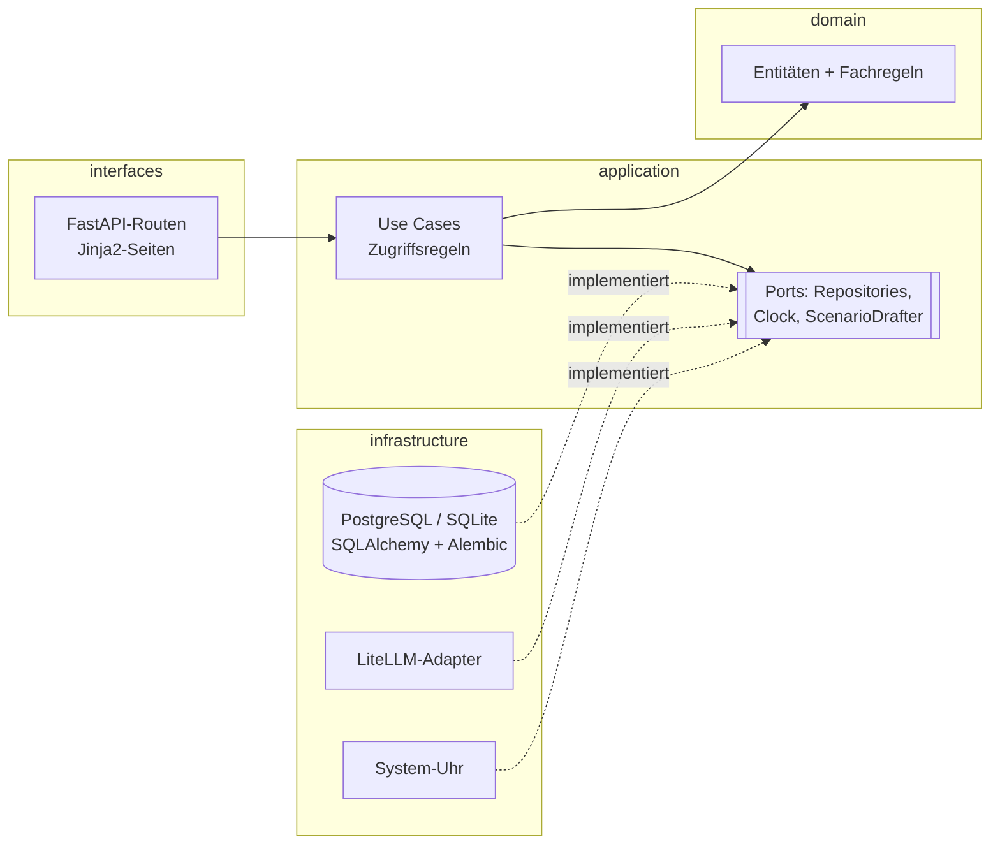
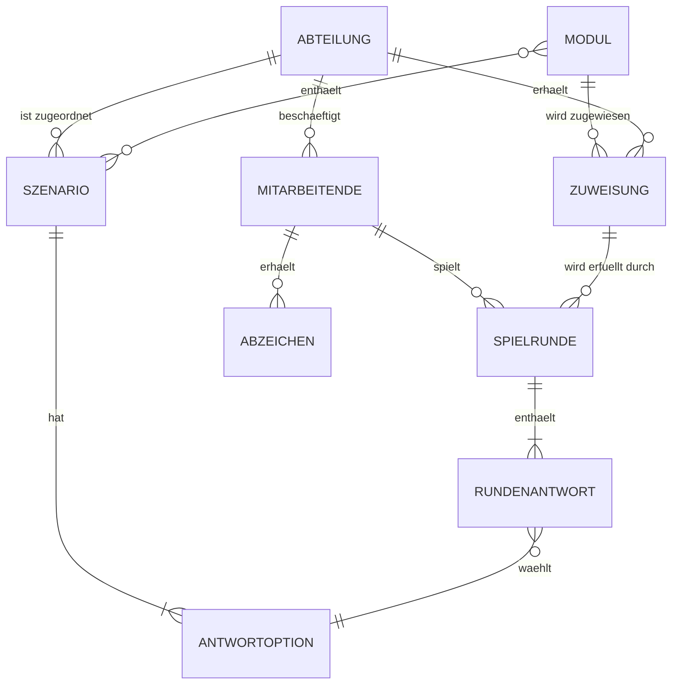

# PROJECT.md

## Purpose

- **Projektname:** Datenschutzszenarien in der Gemeinde
- **Problem:** Gemeindeangestellte bearbeiten täglich Personendaten, zum Beispiel am Schalter, am Telefon oder per E-Mail. Klassische Datenschutz-Schulungen sind trocken, werden selten wiederholt und lassen sich kaum nachweisen. Die Gemeinde weiss nicht, in welchen Abteilungen Risiken bestehen.
- **Lösung:** Eine Compliance-Schulungsplattform. Mitarbeitende üben mit realistischen Alltagsszenarien im Spielformat. Die Gemeinde kann nachweisen, wer geschult ist, und sieht, wo Schwachstellen liegen.
- **Kontext:** Fiktive Schweizer Stadtverwaltung nach dem Vorbild der Stadt Grenchen (Kanton Solothurn, kantonales Informations- und Datenschutzgesetz InfoDG). Es werden ausschliesslich fiktive Daten verwendet.
- **Nutzer:** Mitarbeitende, Abteilungsleitungen, Datenschutzverantwortliche (siehe Rollen)
- **In Scope:**
  - UC-001 Szenario-Runde spielen
  - UC-002 Schulung steuern (Zuweisung mit Frist, Status, Auswertung, CSV-Schulungsnachweis)
  - UC-003 KI-Szenario-Entwurf (optional)
  - Login mit Rollen, Seed-Daten für 3 Abteilungen mit je 5 Szenarien
- **Out of Scope:** Mobile App, SSO, Selbstregistrierung, E-Mail-Benachrichtigungen, echte Daten der Stadt Grenchen, Mehrmandantenfähigkeit, Rechtsberatung

## Architecture

Clean Architecture, Abhängigkeiten zeigen nur nach innen:

`domain ← application ← interfaces ← infrastructure`



| Schicht | Inhalt | Darf importieren |
|---|---|---|
| `domain` | Entitäten, Wertobjekte, Fachregeln (Bewertung, Abzeichen, Fristen, Mindestgruppengrösse) | nur Standardbibliothek |
| `application` | Use Cases, Zugriffsregeln je Rolle, Ports (Protokolle) | `domain` |
| `interfaces` | FastAPI-Routen, Jinja2-Templates, Formulare, CSV-Export | `application`, `domain` |
| `infrastructure` | SQLAlchemy-Modelle und Repositories, Alembic, Passwort-Hashing, Clock, LiteLLM-Adapter, Seed | alle |

Die Schichtenregel wird mit import-linter in der CI geprüft (ab Phase 4).

**Entscheide:** siehe `docs/adr/` (ADR-001 Stack).

## Domain Model



| Entität | Wichtige Attribute |
|---|---|
| Abteilung | Name |
| Mitarbeitende | Benutzername, Passwort-Hash, Anzeigename, Rolle, Abteilung |
| Szenario | Titel, Situation, Erklärung, Rechtsgrundlage, Version, Abteilung, Status (Entwurf / freigegeben) |
| Antwortoption | Text, ist richtig |
| Modul | Name, Szenarien |
| Zuweisung | Modul, Abteilung, Frist |
| Spielrunde | Mitarbeitende, Zuweisung, Start, Ende, Punkte |
| Rundenantwort | Spielrunde, Szenario, Szenario-Version, gewählte Antwortoption, richtig ja/nein |
| Abzeichen | Mitarbeitende, Modul, erhalten am |

## Roles and Permissions

Jede Person hat genau **eine Rolle** und **eine Abteilung**. Abteilungen sind Stammdaten, keine Rollen.

| Rolle | Darf |
|---|---|
| Mitarbeitende | Runden der eigenen Abteilung spielen; nur eigene Ergebnisse und Abzeichen sehen |
| Abteilungsleitung | nur eigene Abteilung: Status pro Person (erledigt / offen / Frist überschritten); Punkte und Fehler nur aggregiert |
| Datenschutzverantwortliche | Szenarien und Module verwalten, Zuweisungen mit Frist erstellen, Auswertung aller Abteilungen, CSV-Schulungsnachweis, KI-Entwürfe freigeben |

Die Zugriffsregeln liegen in `application` und sind durch Unit-Tests abgedeckt.

## Domain Rules

- **Bewertung:** Eine Runde umfasst 5 Szenarien der eigenen Abteilung. Pro richtige Antwort gibt es einen Punkt, nach jeder Antwort wird die Erklärung gezeigt.
- **Abzeichen:** Ab einem Anteil richtiger Antworten von `BADGE_THRESHOLD` (Standard 0.8, also 4 von 5).
- **Wiederholung:** Runden dürfen wiederholt werden. Für Status und Abzeichen zählt der beste Versuch, für die Fehlerauswertung zählen alle Versuche.
- **Fristen:** Eine Zuweisung gilt pro Person als *erledigt*, wenn die Person die Schwelle erreicht hat. Sie ist *offen*, solange die Frist läuft, und *Frist überschritten* danach. Das aktuelle Datum kommt über den Clock-Port und nie direkt aus `datetime.now()`.
- **Mindestgruppengrösse:** Aggregierte Auswertungen werden erst ab `MIN_GROUP_SIZE` Personen angezeigt (Standard 3), sonst erscheint „zu wenige Teilnehmende“.
- **Versionierung:** Ändert jemand ein Szenario, entsteht eine neue Version. Bestehende Rundenantworten behalten ihre Version.
- **Löschfrist (Version 2, nur dokumentiert):** Rundenantworten werden nach 12 Monaten gelöscht, der Status „Schulung erledigt“ bleibt erhalten.

## Structure

Die Ordner entstehen in Phase 3 mit dem ersten Test (leere Ordner speichert Git nicht).

```
src/app/
  domain/            Entitäten, Fachregeln
  application/       Use Cases, Ports, Zugriffsregeln
  interfaces/web/    FastAPI-Routen, Jinja2-Templates
  infrastructure/    SQLAlchemy, Alembic, Hashing, Clock, LiteLLM, Seed
  main.py            App-Erzeugung und Verdrahtung
tests/
  unit/              domain und application, ohne DB und Web
  integration/       Repositories und Endpoints mit Test-DB
  e2e/               Playwright gegen die laufende App
```

## Commands

| Activity | Command |
|---|---|
| Install | `bash scripts/setup-python.sh && source .venv/bin/activate` |
| Unit tests | `pytest tests/unit` |
| Integration tests | `pytest tests/integration` |
| E2E tests | `playwright install chromium && pytest tests/e2e` (in Phase 4 festgelegt) |
| Architecture check | `lint-imports` (Konfiguration in Phase 3) |
| Run locally | `PYTHONPATH=src uvicorn app.main:app --reload` |
| Build/release | Docker-Image, `release.yml` (in Phase 4 festgelegt) |

## Dependencies

- Python 3.12 (`.python-version`)
- Abhängigkeiten in `requirements.txt`. Die Versionen werden in Phase 4 fixiert.
- Lokal SQLite, in Docker und in der Cloud PostgreSQL (Neon). Die App läuft auf Render.

## Configuration

Nur die Namen sind hier dokumentiert, Werte stehen in `.env` (lokal, nicht im Repo) oder in GitHub Secrets. Eine Vorlage liegt in `.env.example`.

| Variable | Zweck |
|---|---|
| `DATABASE_URL` | Datenbankverbindung |
| `SECRET_KEY` | Signatur der Session-Cookies |
| `BADGE_THRESHOLD` | Schwelle für Abzeichen (0–1) |
| `MIN_GROUP_SIZE` | Mindestgrösse für aggregierte Auswertungen |
| `LITELLM_BASE_URL`, `LITELLM_API_KEY`, `LITELLM_MODEL` | Zugriff auf das LLM für UC-003 |
