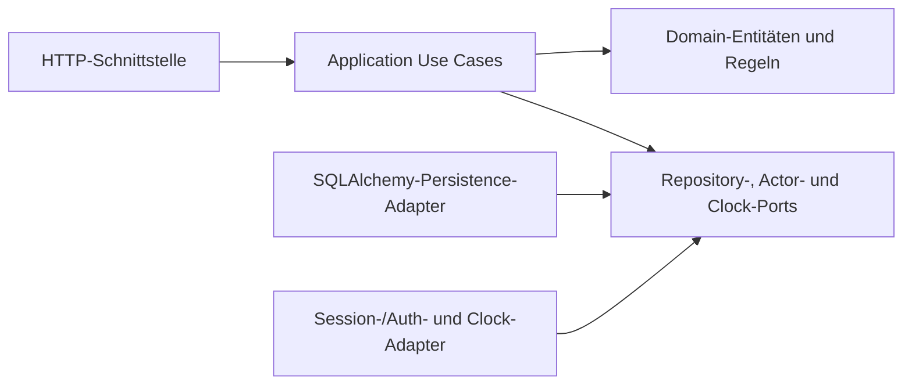

# UC-001: Szenario-Runde spielen

## Intent

Mitarbeitende der Gemeinde Grenchen trainieren Datenschutzsituationen aus ihrer
Abteilung und erhalten einen nachvollziehbaren Schulungsstatus.

## Actors

**Primary**  
Angemeldete Mitarbeitende der Gemeinde Grenchen

**Secondary**  
Abteilungsleitung, Datenschutzverantwortliche, Anwendung

## Preconditions

- Die Person ist angemeldet und einer Abteilung sowie einer Rolle zugeordnet.
- Die Person ist als fiktiver Seed-Demo-Benutzer mit einer hinterlegten
  `@grenchen.example`-Adresse angemeldet. Eine Registrierung ist in V1 nicht
  Teil dieses Use Cases.
- Für die Abteilung der Person existiert eine `Assignment`, die das Modul
  dieser Abteilung mit einer Frist zuweist. Die Person muss der Zielabteilung
  dieser Zuweisung angehören.
- Das Modul enthält genau fünf aktive Datenschutzfälle.
- Jeder Fall ist aktiv und besitzt drei bis vier
  Antwortmöglichkeiten, genau eine richtige Antwort, eine Erklärung und eine
  Rechtsgrundlage.

## Flow

1. Die Mitarbeitende öffnet ein Modul, das ihrer Abteilung zugewiesen ist.
2. Die Anwendung setzt eine offene `GameRound` derselben Person und Zuweisung
   fort. Gibt es keine, startet sie eine neue `GameRound` mit der nächsten
   `attempt_number` und den genau fünf aktiven Fällen des Moduls.
3. Die Anwendung zeigt nacheinander die fünf Fälle und die jeweiligen
   Antwortmöglichkeiten.
4. Die Mitarbeitende wählt eine Antwort und bestätigt sie.
5. Die Anwendung speichert eine `RoundAnswer` mit ausgewählter Antwort und
  Zeitpunkt.
6. Die Anwendung zeigt sofort, ob die Antwort richtig war, sowie Erklärung und
   Rechtsgrundlage des Falls.
7. Nach dem fünften Fall berechnet die Anwendung die Punktzahl und speichert
   sie zusammen mit dem Bestehensstatus auf `GameRound`.
8. Der Versuch gilt ab 80 Prozent richtigen Antworten als bestanden.
9. Die Anwendung zeigt Punktzahl, Bestehensstatus und den bisherigen
   Schulungsfortschritt an.
10. Die Mitarbeitende kann das Modul später erneut spielen. Für die
    Punktanzeige zählt der Versuch mit der höchsten Punktzahl; bei gleicher
    Punktzahl der zuerst abgeschlossene Versuch. Für den Schulungsstatus zählt
    der beste bestandene Versuch. Frühere Versuche bleiben erhalten.
11. Ist die Frist des `Assignment` abgelaufen, darf die Mitarbeitende das Modul
   weiterhin spielen. Für den Trainingsstatus zählt weiterhin der beste
   bestandene Versuch: Liegt dessen Abschluss nach Fristende, lautet der Status
   `verspätet erledigt`; ohne bestandenen Versuch lautet er
   `Frist überschritten`. Bewertung und Bestehensgrenze bleiben unverändert.
12. Schliesst die Mitarbeitende den Browser während der Runde, bleibt die
  `GameRound` mit dem Status `offen` gespeichert. Bereits gespeicherte
  Antworten bleiben erhalten. Beim nächsten Öffnen wird die Runde an der
  offenen Stelle fortgesetzt und erst nach der letzten Antwort abgeschlossen
  und bewertet.

## Errors

- Nicht angemeldet: Zugriff auf das Modul wird verweigert.
- Falsche Rolle: Abteilungsleitung oder Datenschutzverantwortliche können keine
  Mitarbeitenden-Runde starten.
- Fremde Abteilung: Ein Modul einer anderen Abteilung wird nicht angezeigt und
  kann auch über eine direkte Anfrage nicht gestartet werden.
- Ungültige Antwort: Eine Antwort ausserhalb der angebotenen Optionen wird
  abgelehnt und nicht als `RoundAnswer` gespeichert.
- Doppelte Antwort: Eine bereits beantwortete Frage kann in derselben Runde
  nicht nochmals bewertet werden.
- Nicht gefunden: Ein unbekanntes Modul oder ein unbekannter Fall führt zu
  einer kontrollierten Fehlermeldung.
- Falsche Anzahl aktiver Fälle: Ein Modul, das nicht genau fünf aktive Fälle
  enthält, kann keine neue Runde starten.

## Acceptance

### AC-001: Zugewiesenes Modul starten

**Given** eine angemeldete Mitarbeitende und ein ihrer Abteilung zugewiesenes
Modul

**When** sie das Modul öffnet  
**Then** startet die Anwendung eine neue `GameRound` mit genau fünf aktiven
Fällen und der nächsten `attempt_number`, sofern keine offene Runde existiert;
andernfalls setzt sie dieselbe offene Runde fort.

### AC-002: Nur eigene Abteilung

**Given** eine angemeldete Mitarbeitende mit einem Modul ihrer Abteilung  
**When** sie verfügbare Module abfragt  
**Then** sieht sie nur Module aus Zuweisungen, deren Zielabteilung ihre eigene
Abteilung ist.

### AC-003: Antwort speichern

**Given** eine laufende Runde und ein noch nicht beantworteter Fall  
**When** die Mitarbeitende eine angebotene Antwort bestätigt  
**Then** speichert die Anwendung eine `RoundAnswer` mit Antwort und Zeitpunkt.

### AC-004: Sofortiges Feedback

**Given** eine gespeicherte Antwort auf einen Fall  
**When** die Antwort bewertet wurde  
**Then** zeigt die Anwendung sofort richtig oder falsch, die Erklärung und die
Rechtsgrundlage an.

### AC-005: Versuch bestanden

**Given** eine abgeschlossene Runde mit mindestens vier von fünf richtigen
Antworten  
**When** die Anwendung die Runde abschliesst  
**Then** speichert sie die Punktzahl und den Bestehensstatus `bestanden` auf
`GameRound`.

### AC-006: Versuch nicht bestanden

**Given** eine abgeschlossene Runde mit höchstens drei von fünf richtigen
Antworten  
**When** die Anwendung die Runde abschliesst  
**Then** speichert sie die Punktzahl und den Bestehensstatus `nicht bestanden`
auf `GameRound`.

### AC-007: Besten Versuch verwenden

**Given** eine Mitarbeitende hat dasselbe Modul mehrmals gespielt  
**When** der Schulungsstatus angezeigt wird  
**Then** verwendet die Anwendung für die Punktanzeige den Versuch mit der
höchsten Punktzahl (bei Gleichstand den zuerst abgeschlossenen) und für den
Schulungsstatus den besten bestandenen Versuch; frühere Versuche bleiben
unverändert.

### AC-008: Ungültige Antwort ablehnen

**Given** eine laufende Runde  
**When** eine Antwort übermittelt wird, die nicht zu den angebotenen Optionen
gehört  
**Then** lehnt die Anwendung die Antwort ab und speichert keine
`RoundAnswer`.

### AC-009: Fremde Abteilung schützen

**Given** eine angemeldete Mitarbeitende aus Abteilung A und eine Zuweisung an
Abteilung B

**When** sie ein Modul von Abteilung B direkt anfordert  
**Then** verweigert die Anwendung den Zugriff ohne Inhalte oder Ergebnisse des
fremden Moduls preiszugeben.

### AC-010: Modul nach Fristabschluss spielen

**Given** ein der Mitarbeitenden zugewiesenes Modul mit abgelaufener Frist und
bisher keinem bestandenen Versuch
**When** sie das Modul startet und abschliesst  
**Then** bewertet die Anwendung die Runde normal und wendet weiterhin die
Bestehensgrenze von 80 Prozent an. Ein bestandener Abschluss erhält den Status
`verspätet erledigt`; ohne bestandenen Versuch lautet er `Frist überschritten`.

### AC-011: Offene Runde fortsetzen

**Given** eine offene `GameRound` mit bereits gespeicherten Antworten  
**When** die Mitarbeitende das Modul erneut öffnet  
**Then** setzt die Anwendung dieselbe Runde bei der ersten unbeantworteten
Frage fort und bewertet sie erst nach der letzten Antwort.

### AC-012: Deaktiviertes Szenario nicht verwenden

**Given** ein einem Modul zugeordnetes Szenario ist deaktiviert  
**When** eine neue Runde startet  
**Then** wird das deaktivierte Szenario nicht verwendet.

### AC-013: Veröffentlichtes Szenario unveränderlich

**Given** ein veröffentlichtes Szenario mit Antwortoptionen

**When** eine Änderung oder Löschung fachlich angefordert wird

**Then** weist die Domain-/Application-Regel sie ab; der Fall kann deaktiviert
und durch ein neues Szenario ersetzt werden. Eine Verwaltungs-API gehört zu
einem zuständigen späteren Use Case und wird hier nicht entworfen.

## Architekturentwurf (Phase 2)

### Domain

- `Department`, `Employee`, `Module` und `Assignment` liefern den nötigen
  Abteilungs-, Rollen-, Modul- und Fristkontext.
- `Scenario` und `AnswerOption` bilden einen Datenschutzfall ab. Nach der
  Veröffentlichung sind Inhalt und Antwortoptionen unveränderlich; nur
  `Scenario.active` kann zur Deaktivierung geändert werden. Fehlerhafte Fälle
  werden deaktiviert und durch neue ersetzt.
- `GameRound` gehört zu einer Person und einer Zuweisung an deren Abteilung.
  Die Zielabteilung der Zuweisung muss der Abteilung der Person entsprechen.
  Sie speichert
  `attempt_number`, den Status `offen`/`abgeschlossen`, die feste Reihenfolge
  von genau fünf Szenarien und nach Abschluss Zeitpunkt, Punktzahl und
  Bestehensstatus. Zum Start liefert das Modul alle aktiven Szenarien in seiner
  festgelegten Reihenfolge; nur wenn es genau fünf sind, wird die geordnete
  Szenario-ID-Liste in der Runde festgehalten. Eine offene Runde wird mit
  dieser gespeicherten Liste fortgesetzt, auch wenn ein Szenario später
  deaktiviert wird.
- `Module` und `Scenario` werden über `module_scenarios` verbunden. `(module_id,
  position)` ist eindeutig. Ein Ersatz aktualisiert die bestehende Position auf
  die neue Szenario-ID und deaktiviert das alte Szenario. Eine neue Runde
  startet nur bei genau fünf Positionen mit aktiven Szenarien. Die fünf
  Positionen werden zusätzlich in `game_round_scenarios` gespeichert.
- `RoundAnswer` enthält Runde, Szenario-Position, gewählte Option und
  Antwortzeitpunkt. Pro Position ist eine Antwort möglich; beantwortet wird
  die erste offene Position. Eine Option muss zum Szenario gehören.
- Der Versuch besteht ab vier von fünf richtigen Antworten (80 %). Eine
  Wiederholung erzeugt eine neue Runde mit der nächsten `attempt_number`;
  frühere Versuche und Antworten bleiben unverändert. Für die Punktanzeige
  zählt der abgeschlossene Versuch mit der höchsten Punktzahl; bei Gleichstand
  der zuerst abgeschlossene. Für den Trainingsstatus zählt der beste
  bestandene Versuch; bei gleicher Punktzahl der zuerst abgeschlossene
  bestandene Versuch. Dessen Abschlusszeitpunkt bestimmt den Friststatus; ein
  späterer Versuch mit gleicher Punktzahl ändert ihn nicht. Ein Abzeichen wird
  aus dem besten bestandenen Versuch berechnet, nicht als eigene Entität
  gespeichert.
- `GameRound.completed_at` wird beim Abschluss gesetzt. Der Status
  `verspätet erledigt` wird anhand des Abschlusszeitpunkts des besten
  bestandenen Versuchs bestimmt. Ohne bestandenen Versuch gilt bis zum
  Fristende `offen`, danach `Frist überschritten`. Das Fristdatum ist ein lokales
  Kalenderdatum in `Europe/Zurich` und gilt einschliesslich 23:59:59 Ortszeit.
  Die Application reicht den vom `ClockPort` gelieferten Zeitpunkt mit dieser
  Zeitzone an die Domain weiter; Domain und Application lesen die Systemzeit
  nicht selbst.

### Application

- `ListAssignedModules` erhält den authentifizierten Actor und liefert nur
  Module aus Zuweisungen an dessen Abteilung samt eigenem Fortschritt.
- `StartOrResumeGameRound` erhält Modul-/Zuweisungs-ID und Actor. Es liefert
  eine offene Runde oder startet einen Versuch. Die Ausgabe enthält
  Runden-ID, `attempt_number`, geordnete Szenarien/Optionen und die erste
  unbeantwortete Position.
- `SubmitRoundAnswer` erhält Actor, Runden-ID, Szenario-Position und Options-ID.
  Die Ausgabe enthält richtig/falsch, Erklärung, Rechtsgrundlage und entweder
  die nächste Position oder das abgeschlossene Ergebnis samt Trainingsstatus.
- `GetTrainingProgress` erhält Actor und Modul-/Zuweisungs-ID. Es liefert
  Mitarbeitenden den eigenen Status; Abteilungsleitungen den Status ihrer
  Abteilung samt Einzelstatus und Punkt-/Fehleraggregaten erst ab drei
  Personen; Datenschutzverantwortlichen die Gesamtsicht gemäss Projektregeln.
- Die Application prüft alle Zugriffe serverseitig. Mitarbeitende spielen nur
  Module aus Zuweisungen an ihre eigene Abteilung und sehen nur eigene Ergebnisse;
  Abteilungsleitungen bleiben auf ihre Abteilung beschränkt und sehen Punkte
  nur aggregiert ab drei abgeschlossenen Personen. Datenschutzverantwortliche
  sehen die Gesamtauswertung. Nur Mitarbeitende dürfen UC-001-Runden starten
  und beantworten.
- Ports in Application: `AssignmentRepository` lädt Zuweisung und Frist;
  `ScenarioRepository` lädt alle aktiven Szenarien eines Moduls mit Optionen
  in der festgelegten Reihenfolge, damit die Application die Anzahl fünf
  prüfen kann, und lädt für offene Runden gespeicherte Szenario-IDs unabhängig
  vom aktuellen Aktivstatus;
  `GameRoundRepository` lädt offene/beste Versuche und speichert Runde,
  Antworten und Abschluss; `CurrentActorPort` liefert serverseitig
  authentifizierte Person, Rolle und Abteilung; `ClockPort` liefert aktuelles
  Datum bzw. aktuellen Zeitpunkt in der für Fristen festgelegten Zeitzone.

### Interfaces

- `GET /api/modules` listet sichtbare Module und den zulässigen Fortschritt.
- `POST /api/modules/{module_id}/rounds` startet oder setzt eine Runde fort.
- `POST /api/rounds/{round_id}/answers` übermittelt eine Antwort auf die
  nächste offene Position und liefert Feedback sowie gegebenenfalls das
  Endergebnis.
- `GET /api/modules/{module_id}/progress` liefert den rollenabhängig
  gefilterten Fortschritt.

| Fehlerfall | HTTP-Status |
|---|---:|
| Nicht angemeldet | 401 |
| Falsche Rolle für Starten/Antworten | 403 |
| Modul einer fremden Abteilung (ohne Inhaltsleck) | 404 |
| Ungültige oder nicht zum Szenario gehörende Antwort | 422 |
| Doppelte Antwort auf dieselbe Position | 409 |
| Unbekanntes Modul, Runde oder Szenario | 404 |
| Modul enthält nicht genau fünf aktive Szenarien | 409 |

POST-Anfragen verwenden die bestehende Session und CSRF-Prüfung. Für AC-013
wird in UC-001 kein Szenario-Verwaltungsendpunkt ergänzt.

### Infrastructure

- SQLAlchemy-Adapter implementieren die Repository-Ports. PostgreSQL ist die
  Laufzeit-/Deployment-Datenbank; SQLite kann lokal und in automatisierten
  Tests verwendet werden.
- Ein Session-/Authentifizierungsadapter implementiert `CurrentActorPort` und
  liest die geschützte Session. Login- und Registrierungsabläufe sind nicht
  Teil dieses UC. CSRF wird für die schreibende Antwortanfrage geprüft.
- Ein Clock-Adapter implementiert `ClockPort`; die Application übergibt das
  gelieferte Datum bzw. den Zeitpunkt an die Domainregeln.

## Tests

Die folgenden Fälle beschreiben E2E-API-Prüfungen. In Phase 2 werden keine
Testdateien oder Testimplementierungen erstellt.

| Kriterium | API-Fall und erwartetes Ergebnis |
|---|---|
| AC-001 | Mitarbeitende öffnen ein eigenes Modul ohne offene Runde: POST start liefert 201, die nächste `attempt_number` und genau fünf Szenarien in fester Reihenfolge. Mit offener Runde liefert derselbe Aufruf 200 und dieselbe Runde. |
| AC-002 | GET Module als Mitarbeitende liefert nur zugewiesene Module der eigenen Abteilung. |
| AC-003 | Eine gültige Antwort auf die nächste Position liefert 201; beim erneuten Öffnen ist die Antwort gespeichert und die Position erledigt. |
| AC-004 | Die Antwort enthält korrekt/falsch, Erklärung und Rechtsgrundlage des beantworteten Falls. |
| AC-005 | Eine Runde mit vier oder fünf richtigen Antworten wird beim letzten Submit abgeschlossen, mit Punktzahl gespeichert und als bestanden ausgewiesen. |
| AC-006 | Eine Runde mit null bis drei richtigen Antworten wird abgeschlossen und als nicht bestanden ausgewiesen. |
| AC-007 | Nach mehreren abgeschlossenen Versuchen liefert GET progress den Versuch mit der höchsten Punktzahl; bei gleicher Punktzahl den zuerst abgeschlossenen. Frühere Ergebnisse bleiben unverändert. |
| AC-008 | Eine Option, die nicht zum angezeigten Szenario gehört, ergibt 422; die Runde bleibt an derselben Position und enthält keine Antwort dafür. |
| AC-009 | Eine Mitarbeitende fordert direkt ein Modul einer fremden Abteilung an: 404 ohne Modulinhalt oder Ergebnisdaten. |
| AC-010 | Nach Fristablauf einen bestandenen Versuch abschliessen: normale Bewertung und Status `verspätet erledigt`. Wird die Runde nicht bestanden, bleibt der Status `Frist überschritten`. |
| AC-011 | Eine offene Runde mit gespeicherten Antworten wird erneut geöffnet: gleiche Runden-ID, nächste offene Position, keine zusätzliche Runde. |
| AC-012 | Ein Modul mit genau fünf aktiven plus deaktivierten Szenarien startet mit den fünf aktiven; deaktivierte Szenarien erscheinen nicht. |
| AC-013 | Im UC-001-API ist kein Szenario-Verwaltungsendpunkt verfügbar: `PATCH` und `DELETE /api/scenarios/{scenario_id}` werden mit 404 abgewiesen, und ein anschliessender Rundenaufruf liefert weiterhin den unveränderten Szenarioinhalt. Die fachliche Unveränderlichkeit wird zusätzlich durch Domain-/Application-Prüfungen abgesichert; Verwaltungsendpunkte gehören zu einem späteren Use Case. |

Zusätzliche API-Fälle zu AC-007/AC-010:

- Zwei abgeschlossene Versuche mit gleicher Punktzahl: GET progress verwendet
  den zuerst abgeschlossenen Versuch samt dessen Abschlusszeitpunkt.
- Ein gleicher späterer Versuch nach Fristablauf: der frühere, fristgerechte
  Versuch bleibt für den Trainingsstatus massgeblich; der Status wird nicht
  verspätet.
- Zwei gleich gute verspätete Versuche: GET progress verwendet den zuerst
  abgeschlossenen verspäteten Versuch samt Abschlusszeitpunkt als Nachweis.

Weitere Fehlerfallprüfungen: ohne Session 401, falsche Rolle 403, doppelte
Antwort 409, unbekannte ID 404 und Modul mit nicht genau fünf aktiven
Szenarien 409. Für AC-010 prüft der API-Fall zudem, dass der Fristtag bis
23:59:59 in `Europe/Zurich` rechtzeitig ist und ein Abschluss ab dem Folgetag
als verspätet gilt. Playwright-Code und Browserprüfungen liegen ausdrücklich
ausserhalb dieser Phase.
