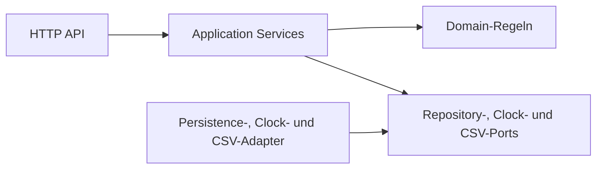

# UC-002: Schulung steuern

## Intent

Die Datenschutzverantwortliche weist Schulungsmodule mit Fristen zu und kann
nachvollziehen, welche Mitarbeitenden geschult sind. Abteilungsleitungen sehen
nur die zulässigen Informationen ihrer eigenen Abteilung.

## Actors

**Primary**  
Datenschutzverantwortliche

**Secondary**  
Abteilungsleitung, Mitarbeitende, Anwendung

## Preconditions

- Die Datenschutzverantwortliche ist angemeldet und ihrer hinterlegten
  `@grenchen.example`-Adresse zugeordnet.
- Module und aktive Datenschutzfälle existieren.
- Mitarbeitende gehören jeweils genau einer Abteilung an.
- Für jede Zuweisung sind Modul, Zielabteilung und Frist festgelegt.
- Der aktuelle Zeitpunkt wird über einen Clock-Port oder als Parameter an die
  Statuslogik übergeben.

## Flow

1. Die Datenschutzverantwortliche öffnet die Modulverwaltung.
2. Sie wählt ein Modul, eine Abteilung und eine Frist aus.
3. Die Anwendung prüft die Eingaben und speichert eine `Assignment`.
4. Die zugewiesenen Mitarbeitenden sehen das Modul und ihren persönlichen
   Schulungsstatus.
5. Die Anwendung berechnet den Status anhand des besten abgeschlossenen
  Versuchs und der Frist: `offen`, `erledigt`, `verspätet erledigt` oder
  `Frist überschritten`.
6. Die Datenschutzverantwortliche sieht den Status und aggregierte Ergebnisse
   aller Abteilungen.
7. Die Abteilungsleitung sieht nur den Status pro Person der eigenen Abteilung.
   Punkte und Fehler werden nur als Teamwerte aggregiert angezeigt.
8. Teamwerte werden erst ab mindestens drei Personen mit abgeschlossenem
  Versuch angezeigt.
9. Ausschliesslich die Datenschutzverantwortliche kann einen Schulungsnachweis
  als CSV mit Person, Modul und Abschlusszeitpunkt exportieren.

## Errors

- Nicht angemeldet: Zugriff auf Zuweisungen und Auswertungen wird verweigert.
- Falsche Rolle: Mitarbeitende und Abteilungsleitungen dürfen keine Module
  zuweisen. Eine Abteilungsleitung erhält beim CSV-Export HTTP 403.
- Fremde Abteilung: Eine Abteilungsleitung kann keine Status- oder
  Detailauswertung einer anderen Abteilung abrufen.
- Ungültige Eingabe: Ein fehlendes Modul, eine fehlende Abteilung oder eine
  ungültige beziehungsweise fehlende Frist wird abgelehnt.
- Nicht gefunden: Ein unbekanntes Modul oder eine unbekannte Abteilung führt zu
  einer kontrollierten Fehlermeldung.
- Zu kleine Gruppe: Teamwerte werden bei weniger als drei Personen nicht
  angezeigt; stattdessen erscheint `zu wenige Teilnehmende`.
- Fehlender Schulungsnachweis: Ein CSV-Export ohne gültige Zuweisung wird
  abgelehnt.

## Acceptance

### AC-001: Modul zuweisen

**Given** eine angemeldete Datenschutzverantwortliche und ein gültiges Modul  
**When** sie das Modul einer Abteilung mit einer gültigen Frist zuweist  
**Then** speichert die Anwendung eine `Assignment` mit Modul, Abteilung und
Frist.

### AC-002: Zuweisung validieren

**Given** eine neue Zuweisung  
**When** Modul, Abteilung oder Frist fehlt oder ungültig ist  
**Then** weist die Anwendung die Zuweisung ab und speichert sie nicht.

### AC-003: Status offen

**Given** eine gültige Zuweisung ohne bestandenen Versuch und eine noch nicht
abgelaufene Frist  
**When** der Schulungsstatus berechnet wird  
**Then** lautet der Status `offen`.

### AC-004: Status erledigt

**Given** eine gültige Zuweisung mit einem bestandenen Versuch  
**When** der Schulungsstatus berechnet wird  
**Then** lautet der Status `erledigt`.

### AC-005: Status Frist überschritten

**Given** eine gültige Zuweisung ohne bestandenen Versuch, unabhängig davon, ob
eine Runde gestartet wurde, und eine abgelaufene Frist  
**When** der Schulungsstatus mit dem aktuellen Zeitpunkt berechnet wird  
**Then** lautet der Status `Frist überschritten`.

### AC-006: Status verspätet erledigt

**Given** eine gültige Zuweisung mit einem bestandenen Versuch nach Ablauf der
Frist  
**When** der Schulungsstatus berechnet wird  
**Then** lautet der Status `verspätet erledigt`.

### AC-007: Eigenen Status anzeigen

**Given** eine angemeldete Mitarbeitende mit einer Zuweisung  
**When** sie ihren Schulungsstatus abfragt  
**Then** sieht sie nur ihren eigenen Status und ihre eigenen Ergebnisse.

### AC-008: Abteilungsstatus anzeigen

**Given** eine angemeldete Abteilungsleitung  
**When** sie die Schulungsstatus ihrer Abteilung abfragt  
**Then** sieht sie pro Person nur den Status `erledigt`, `offen`, `verspätet
erledigt` oder `Frist überschritten`.

### AC-009: Fremde Abteilung schützen

**Given** eine Abteilungsleitung aus Abteilung A  
**When** sie eine Auswertung für Abteilung B anfordert  
**Then** verweigert die Anwendung den Zugriff.

### AC-010: Teamwerte ab drei Personen

**Given** eine Abteilungsleitung und mindestens drei Personen mit
abgeschlossenem Versuch in ihrer Abteilung
**When** sie die Team-Auswertung abfragt  
**Then** sieht sie aggregierte Punkte und Fehler der Abteilung, aber keine
individuellen Punkte oder Fehler.

### AC-011: Teamwerte unter drei Personen schützen

**Given** eine Abteilungsleitung und weniger als drei Personen mit einem
abgeschlossenen Versuch
**When** sie die Team-Auswertung abfragt  
**Then** zeigt die Anwendung keine Teamwerte und den Hinweis `zu wenige
Teilnehmende`.

### AC-012: Vollständige Auswertung

**Given** eine angemeldete Datenschutzverantwortliche  
**When** sie die Schulungsauswertung öffnet  
**Then** sieht sie die zulässige Auswertung aller Abteilungen.

### AC-013: CSV exportieren

**Given** eine angemeldete Datenschutzverantwortliche und eine gültige
Zuweisung  
**When** sie den Schulungsnachweis exportiert  
**Then** erhält sie eine CSV-Datei mit Person, Modul und Abschlusszeitpunkt.

### AC-014: CSV-Export für Abteilungsleitung verweigern

**Given** eine angemeldete Abteilungsleitung  
**When** sie den Schulungsnachweis als CSV exportieren möchte  
**Then** verweigert die Anwendung den Zugriff mit HTTP 403.

### AC-015: Aktuellen Zeitpunkt verwenden

**Given** eine Zuweisung ohne bestandenen Versuch  
**When** der Status mit einem übergebenen Zeitpunkt vor oder nach der Frist
berechnet wird  
**Then** ist das Ergebnis entsprechend `offen`, `erledigt`, `verspätet
erledigt` oder `Frist überschritten`, ohne die Systemzeit direkt in Domain oder
Application aufzurufen.

## Entwurf (Phase 2)

### Domain

- `Assignment` bindet ein vorhandenes `Module` an genau eine `Department` und
  hält ein Fristdatum als lokales Kalenderdatum. `TrainingStatus` hat genau die
  Werte `offen`, `erledigt`, `verspätet erledigt` und `Frist überschritten`.
  Die Zuweisungsregeln verlangen Modul, Zielabteilung und ein gültiges Datum;
  fachlich wird vor dem Speichern geprüft.
- Die Statusregel erhält einen Zeitpunkt als Argument. Das Fristdatum gilt in
  `Europe/Zurich` einschliesslich 23:59:59 Uhr am angegebenen lokalen Datum;
  der Zeitpunkt des Versuchsabschlusses wird vor dem Vergleich in diese
  Zeitzone umgerechnet. Für den Status zählt der beste bestandene Versuch unter
  den abgeschlossenen Versuchen der Person für die Zuweisung; bei gleicher
  Punktzahl gilt der zuerst abgeschlossene bestandene Versuch. Bis zum
  Fristende `erledigt`, danach `verspätet erledigt`. Gibt es keinen bestandenen
  Versuch, gilt bis zum Fristende `offen`, danach `Frist überschritten`.
- Für persönliche Punkte/Fehler und Teamwerte werden je Person die Werte des
  abgeschlossenen Versuchs mit der höchsten Punktzahl verwendet; bei
  Punktgleichstand gilt der zuerst abgeschlossene Versuch. Eine Teamaggregation zählt
  unterschiedliche Personen mit mindestens einem abgeschlossenen Versuch.
  Unter drei Personen wird kein Punkte- oder Fehlerwert gebildet; ab drei
  Personen werden die Werte aggregiert.
- Ein Datensatz für den Schulungsnachweis enthält Person, Modul und
  Abschlusszeitpunkt. Individuelle Punkte und Fehler gehören nicht in die
  Abteilungsleitungs-Ausgabe.
- Domain-Objekte und Regeln kennen weder HTTP noch Persistenzframeworks und
  lesen keine Systemzeit.

### Application

Alle Services erhalten eine authentifizierte Principal-Identität. Rolle und
Abteilung stammen aus serverseitig geladenen Employee-Daten, nie aus
eingereichten Rollen- oder Abteilungswerten. Die Application erzwingt die
Zugriffsregeln und validiert Eingaben vor dem Aufruf der Repository-Ports.

| Service | Eingabe | Ausgabe |
|---|---|---|
| `AssignModule` | Principal, Modul-ID, Abteilungs-ID, Fristdatum (`YYYY-MM-DD`) | gespeicherte `Assignment` |
| `GetPersonalStatus` | Principal, optional Zuweisungsfilter, Zeitpunkt vom Clock-Port | eigene Statuswerte und eigene beste Ergebnisse |
| `GetDepartmentStatus` | Principal, angeforderte Abteilungs-ID, optional Zuweisungsfilter, Zeitpunkt | Status pro Person; keine Einzelpunkte oder Einzelfehler |
| `CreateTeamAggregation` | Principal, Abteilungs-ID, optional Zuweisungsfilter | Aggregat aus Punkte- und Fehlerwerten oder `zu wenige Teilnehmende` |
| `GetOverallEvaluation` | Principal, optional Filter, Zeitpunkt vom Clock-Port | Status und zulässige Auswertungen aller Abteilungen |
| `ExportTrainingEvidence` | Principal, Zuweisungs-ID | CSV-Inhalt mit Person, Modul und Abschlusszeitpunkt |

`AssignModule` ist nur für Datenschutzverantwortliche erlaubt. Mitarbeitende
erhalten ausschliesslich eigene Status- und Ergebnisdaten. Abteilungsleitungen
erhalten Status pro Person nur für ihre hinterlegte Abteilung; Punkte und
Fehler erhalten sie ausschliesslich als Teamaggregation ab drei Personen mit
abgeschlossenem Versuch. Datenschutzverantwortliche können alle Abteilungen
auswerten und Nachweise exportieren. Der CSV-Service verweigert andere Rollen
serverseitig.

Repository-Ports liegen in `application`: `AssignmentRepository` zum Speichern
und Lesen von Zuweisungen, `EmployeeRepository` für Mitarbeitende einer
Abteilung, `DepartmentRepository` und `ModuleRepository` für Existenz- und
Stammdatenprüfungen sowie `GameRoundRepository` für abgeschlossene Runden und
den besten Versuch. `ClockPort` liefert einen zeitzonenbewussten Zeitpunkt;
die Application übergibt diesen der Domainregel und liest keine Systemzeit
direkt. `TrainingEvidenceCsvPort` nimmt die zulässigen Nachweisdaten entgegen
und liefert CSV-Inhalt für den HTTP-Download.

### Interfaces

Die minimale Schnittstelle ist eine HTTP-API für die E2E-API-Fälle:

| Endpoint | Zweck | Erfolg |
|---|---|---|
| `POST /api/assignments` | Modul einer Abteilung mit Frist zuweisen (nur Datenschutzverantwortliche) | `201` |
| `GET /api/me/training-status` | persönlichen Status und eigene Ergebnisse lesen | `200` |
| `GET /api/departments/{department_id}/training-status` | Status der Abteilung lesen | `200` |
| `GET /api/departments/{department_id}/training-aggregation` | geschützte Teamwerte lesen | `200` |
| `GET /api/training/evaluation` | Gesamtauswertung lesen | `200` |
| `GET /api/assignments/{assignment_id}/training-evidence.csv` | Schulungsnachweis exportieren | `200`, `text/csv` |

Die API antwortet mit `401` bei fehlender Anmeldung, `403` bei falscher Rolle
oder fremder Abteilung, `422` bei ungültiger Eingabe oder ungültigem
Fristdatum und `404` bei unbekanntem
Modul, unbekannter Abteilung oder unbekannter Zuweisung. Der CSV-Export durch
eine Abteilungsleitung liefert ausdrücklich `403`. Unter drei Personen liefert
die Aggregationsressource `200` mit `zu wenige Teilnehmende` und ohne Teamwerte.

### Infrastructure

- Persistence-Adapter implementieren die Application-Ports für `Assignment`,
  `Employee`, `Department`, `Module` und abgeschlossene `GameRound`-Daten.
  Zu UC-002 gehört hier nur die Adaptergrenze; SQLAlchemy-Implementierung und
  Datenbankschema werden nicht entworfen.
- Ein System-Clock-Adapter liefert einen zeitzonenbewussten UTC-Zeitpunkt an
  den `ClockPort`; Domain und Application greifen nicht direkt auf die
  Systemzeit zu.
- Ein CSV-Export-Adapter implementiert `TrainingEvidenceCsvPort` und
  serialisiert die zulässigen Nachweisdaten. Der HTTP-Endpunkt liefert den
  erzeugten Inhalt als `text/csv`-Download.

## Tests (Entwurf)

Die folgenden konkreten E2E-API-Fälle decken die Akzeptanzkriterien ab. Sie
verwenden ausschliesslich fiktive Mitarbeitende, Abteilungen, Module und Runden
sowie kontrollierte Zeitpunkte; dies beschreibt Tests, legt aber keine
Testdateien oder Implementierung an.

| Kriterium | E2E-API-Fall und erwartetes Ergebnis |
|---|---|
| AC-001 | Als Datenschutzverantwortliche ein vorhandenes Modul mit Abteilung und gültiger Frist via `POST /api/assignments` zuweisen; `201`, danach enthält der Datensatz Modul, Abteilung und Frist. |
| AC-002 | Je einen POST mit fehlender Modul-ID, Abteilungs-ID oder Fristdatum sowie ungültigem Datumsformat senden; alle liefern `422` und erzeugen keine Zuweisung. |
| AC-003 | Eine Zuweisung ohne bestandenen Versuch mit kontrollierter Zeit vor und genau am lokalen Fristende (23:59:59 Europe/Zurich) abfragen; beide Male `offen`. |
| AC-004 | Eine Zuweisung mit bestandenem Versuch bis einschliesslich 23:59:59 Uhr am Fristdatum in `Europe/Zurich` abfragen; Status `erledigt`. |
| AC-005 | Zuweisung ohne bestandenen Versuch ab dem Folgetag in `Europe/Zurich` abfragen, einmal ohne gestartete Runde und einmal mit nicht abgeschlossener Runde; Status jeweils `Frist überschritten`. |
| AC-006 | Zuweisung ohne früheren bestandenen Versuch mit bestandenem Abschluss am Folgetag nach dem lokalen Fristdatum abfragen; Status `verspätet erledigt`. |
| AC-007 | Als Mitarbeitende den eigenen Status abrufen und eine fremde Mitarbeiter-ID als Filter übermitteln; die Antwort enthält nur eigene Status- und Ergebnisdaten, der fremde Filter wird abgewiesen. Nicht angemeldet liefert `401`. |
| AC-008 | Als Abteilungsleitung die eigene Abteilung abfragen; Antwort enthält pro Person nur einen der vier Statuswerte und keine individuellen Punkte oder Fehler. |
| AC-009 | Als Leitung von Abteilung A den Status von Abteilung B anfordern; `403` und keine Statusdaten von B. |
| AC-010 | Für drei verschiedene Personen der eigenen Abteilung abgeschlossene Versuche bereitstellen und die Teamaggregation abrufen; aggregierte Punkte und Fehler erscheinen, keine Einzelwerte oder identifizierbaren Versuchsdaten. |
| AC-011 | Aggregation zunächst mit zwei, dann mit null abgeschlossenen Personen abrufen; jeweils `200` mit `zu wenige Teilnehmende` und ohne Punkte- oder Fehlerwerte. |
| AC-012 | Als Datenschutzverantwortliche Gesamtauswertung abrufen; Status und zulässige Auswertung enthalten alle fiktiven Abteilungen und Zuweisungen. |
| AC-013 | Als Datenschutzverantwortliche für eine gültige Zuweisung CSV exportieren; `200`, `text/csv`, mit Person, Modul und Abschlusszeitpunkt für abgeschlossene Nachweise. |
| AC-014 | Als Abteilungsleitung denselben CSV-Endpunkt aufrufen; `403`, ohne CSV-Inhalt. |
| AC-015 | Dieselbe Zuweisung ohne bestandenen Versuch mit kontrolliertem Zeitpunkt vor, genau am Fristende (23:59:59) und ab dem Folgetag in `Europe/Zurich` abfragen; der Status wechselt von `offen` zu `Frist überschritten`, ohne direkte Systemzeitabhängigkeit. |

Zusätzlicher E2E-Fall: Zwei bestandene Versuche mit gleicher Punktzahl und
unterschiedlichen Abschlusszeitpunkten bereitstellen. Status und Nachweis
verwenden den zuerst abgeschlossenen Versuch.

Zusätzlich werden die Fehlerverträge durch E2E-Aufrufe geprüft: unangemeldete
Zugriffe `401`, unzulässige Rollen und fremde Abteilungen `403`, ungültige
Eingaben `422`, unbekannte Modul-/Abteilungs-/Zuweisungs-IDs `404` und
CSV-Export ohne gültige Zuweisung `404`. Diese Fälle verwenden dieselben
Endpunkte wie die Akzeptanzfälle oben.

## Quality Gate Phase 2

| Prüfung | Befund | Evidenz |
|---|---|---|
| UC-002-Akzeptanzkriterien und E2E-Fälle | Abgedeckt | Die Tabelle oben ordnet AC-001 bis AC-015 je einem konkreten API-Fall zu. |
| Schichten, Ports und Datenschutzregeln | Abgedeckt | Entwurf benennt Domain, Application, Interfaces und Infrastructure; Rollen, Abteilungen, Aggregationsschwelle und CSV-Recht sind explizit. |
| Implementierung/Testdateien | Keine erstellt | Änderung beschränkt sich auf diesen Entwurf in der UC-Spezifikation. |
| Lifecycle-Router | Erfüllt | `docs/TASKS.md` steht auf PHASE 2 / STATUS in-progress und führt UC-001 als Current Use Case; UC-002 bleibt als entworfener Use Case im Backlog. |
| Gemeinsames Architekturdiagramm | Erfüllt | `docs/PROJECT.md` enthält jetzt das gemeinsame Mermaid-Diagramm; dieser Entwurf zeigt zusätzlich die UC-002-Komponenten. |

Der Quality Gate ist geprüft; STATUS bleibt gemäss Auftrag `in-progress`.
Die Frist ist ein lokales Kalenderdatum in `Europe/Zurich` und gilt bis
einschliesslich 23:59:59 Uhr.
